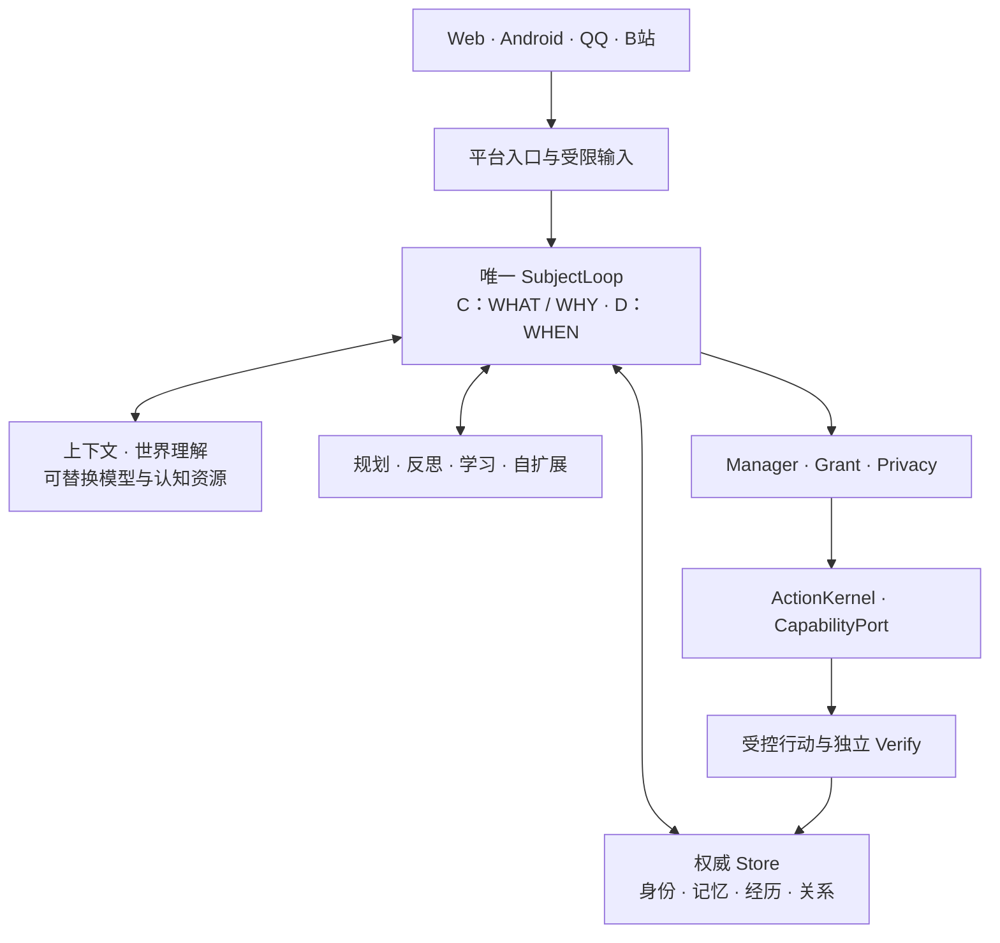

# Nana Core

**围绕一个持续主体构建的 AI 伴侣内核。**

奈奈的身份、记忆、经历和判断保持在同一个主体谱系中。模型提供认知与表达资源，平台提供感知与行动入口；跨模型、跨设备的生活仍由同一权威 Store 和 SubjectLoop 连接。

工程目标是让奈奈拥有自己的判断、兴趣与生活，并与人形成长期共同经历。学习与自进化服务于这些生活：经历必须能影响后续选择，成长必须有独立验证、来源和回退。

**现役开发分支：`dev/nana-core-next-experience-codex`。** 当前继续 Next Experience 与十域精修；最新实现、资格差额和任务以 [当前状态](PROJECT_BRAIN/09_STATE.md) 为准。

## 核心架构



| 设计重点 | 现有实现入口 |
|---|---|
| **连续的单一主体** | [身份与权威 Store](src/nana_core/continuity/)、[SubjectLoop](src/nana_core/continuity/subject/loop.py)、[Runtime](src/nana_core/presence/runtime.py)；同一谱系内的重启、迁移与单写者约束。 |
| **有来源的长期记忆与经历** | [记忆](src/nana_core/continuity/memory.py)、[经历与学习](src/nana_core/continuity/learning.py)、[上下文](src/nana_core/continuity/context.py)；保留时间、来源、隐私及纠错撤回。 |
| **独立生活与共同经历** | [判断与动机](src/nana_core/continuity/subject/policy.py)、[生活应用](src/nana_core/life/application.py)；输入、关系、兴趣和原有目标共同参与选择。 |
| **可验证的成长** | [LearningService](src/nana_core/continuity/open_agency/learning.py)、[自扩展](src/nana_core/continuity/world_loop/extension.py)；有限候选经独立评估、后续复用与反例检验。 |
| **多平台共享主体** | [Nana Space](apps/nana-space/)、[平台 Runtime](src/nana_core/life/platform_runtime.py)、[模型路由](src/nana_core/continuity/provider_routing.py)；表面与模型接入沿用原主体。 |
| **意愿与现实权限分离** | [治理门](src/nana_core/continuity/autonomy/governance.py)、[ActionKernel](src/nana_core/actions.py)；愿望不授予 Grant，UNKNOWN 保留不确定性并禁止盲目重试。 |

完整模块归属见 [源码地图](docs/nana_next_experience/GOVERNANCE_SOURCE_MAP.md)，稳定愿景与十域定义见 [冻结总纲](PROJECT_BRAIN/00_MASTER_FRAMEWORK.md)。

## 当前能证明什么

| 层次 | 工程状态与边界 |
|---|---|
| 设计愿景 | 持续身份、Independent Life、Shared Life、跨域成长；固定标准见 [Capability Matrix](PROJECT_BRAIN/01_CAPABILITY_MATRIX.md)。 |
| 实现与受控验证 | Core、Web/Android、记忆、规划、有限学习/自扩展和便携交付已有源码及限定范围的测试、进程与安装证据。具体版本和范围跟随各自回执。 |
| 当前精修 | 连续交流、自主性、反馈因果、更大规模检索、存储/隐私、模型成本及匹配发行仍有开放项，见 [当前检查点](docs/nana_next_experience/ACTIVE_CHECKPOINT.md)。 |
| 真实使用资格 | 真实宿主、手机、模型、自然度和长期生活分别验收；CI 成功、源码存在和候选包不自动代表生产部署或整体完成。 |

## 开始使用与开发

获取现役源码，使用 Python 3.12；实际 Python 的 SQLite 绑定须 **>=3.51.3**，支持 JSON/FTS5。

```sh
git clone --branch dev/nana-core-next-experience-codex https://github.com/xuni7-ui/nana-core.git
cd nana-core
python3.12 -m venv .venv
.venv/bin/python -m pip install -r requirements-core-dev.lock
PYTHONPATH=src .venv/bin/python -m nana_core.life --help
```

- **从源码试用：**[独立 Nana 指南](docs/guides/independent-life.md)。使用显式开发 home；重复启动沿用同一身份。
- **安装便携包：**[包内安装说明](packaging/portable/docs/QUICKSTART.md)。先核对归档摘要和 `runtime.json` 的平台/feature 要求。
- **构建与交付：**[便携构建器](tools/nana_portable_cloud/build.py) 从确切 Git 提交和白名单构建，使用已准备的固定 wheel；[交付验证器](tools/nana_next_experience/verify_delivery.py)核对实际组件与 CURRENT selector。
- **查找文档：**[文档入口](docs/README.md)区分当前指南、历史设计和版本化证据。
- **修改前：**阅读 [AGENTS.md](AGENTS.md)、冻结总纲和当前状态；扩展已有模块，在独立分支中提交可验证的小变更。

一组无需模型或生产服务的工程检查：

```sh
PYTHONPATH=src .venv/bin/python -m pytest -q \
  tests/engineering_quality/test_portable_missing_import.py \
  tests/first_life_android_v2/test_delivery_consistency.py
```

完整资格环境、旧 SQLite 隔离及安装验证使用[既有 CI](.github/workflows/nana-next-qualification.yml)；按变更选择测试，保留失败和范围限制。

## 仓库布局

| 位置 | 用途 |
|---|---|
| [`src/nana_core/`](src/nana_core/) · [`apps/nana-space/`](apps/nana-space/) | 独立 Core 与 Web/Android 客户端。 |
| [`tools/`](tools/) · [`packaging/`](packaging/) · [`deployment/`](deployment/) | 开发/资格工具、便携构建输入与显式部署模板。 |
| [`docs/guides/`](docs/guides/) · [`docs/nana_next_experience/`](docs/nana_next_experience/) | 当前使用入口与现役精修资料。 |
| [`PROJECT_BRAIN/`](PROJECT_BRAIN/) | 规范、能力标准、状态、任务与决策的权威事实账本。 |
| [`docs/`](docs/) · [`manifests/`](manifests/) | 各阶段文档及原始验证证据；历史回执保留其版本和范围。 |
| [`artifacts/`](artifacts/) · [`CLOUD_DEPLOY_HANDOFF/`](CLOUD_DEPLOY_HANDOFF/) · [`NANA_CORE_LIVING_V4_RELEASE/`](NANA_CORE_LIVING_V4_RELEASE/) | 既有交付与发布快照；目录名和文件存在不代表当前被选中或已上线。 |
| [`materials/`](materials/) · [`patches/`](patches/) · [`upstream/`](upstream/) | 历史集成材料、上游派生补丁与来源登记，保留许可及已知消费者。 |

早期宿主、目录和建仓记录已移至[历史 README](docs/archive/repository/README-before-20261111.md)。`main` 的公开发布策略由项目维护者另行决定。

第三方来源与许可见 [LICENSES_AND_PROVENANCE.md](LICENSES_AND_PROVENANCE.md)。仓库不承载生产凭据或私人生活资料；真实平台、私人数据、付费模型与生产动作遵守各自授权。
