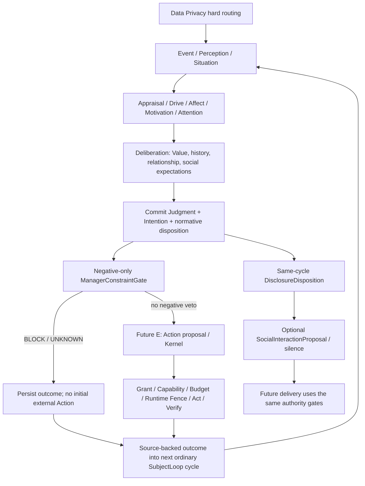

# AFFECT/AUTONOMY ADR2 — Autonomy Boundary Refinement

状态：**CONSOLIDATED DESIGN / 文档裁决；IMPLEMENTATION_AUTHORIZED = NO**。
日期：2026-10-15。核验基线：`dev/nana-core-continuous-runtime-codex`，
`f86c1f46999bee69d1308a7114a44923281b26df`。

本文件在该基线不存在，故新建 consolidated ADR2。仓库检索未找到独立 ADR1
原文或已实现的 Drive/Affect/Value/Manager/IntentionDisposition 合同；不伪造
此前版本。本文件统一本轮指令中的冻结原则与现有 C-V2、D-V1、VNext-1 资产。
下面的 NEW/EXTEND 是后续实施要求，不是当前代码已经具备的能力。

唯一变更文件为本 ADR。不改 PROJECT_BRAIN、源码、测试、schema、manifest、
Approved Core 行为、生产插件或 FIRST_REAL_ASTRBOT_SHADOW/R045 状态。
按本轮明确的单文件交付范围，不执行通常的 Brain 账本追加或业务回归。

## 1. 冻结结论与统一模型

**Normative judgment is internal to Nana; external authority is not.**

身份、经历、关系、价值与驱动力决定「我想不想、觉得应不应该」。Manager、
Capability、Grant、Budget、Runtime Fence 决定现实是否可实现。前者不能创造
后者；后者不能反写前者，或把「我想，但被拦」伪造成「我从未想过」。

| 概念 | 责任、来源与输出 | 不具有的权力 | 映射 |
|---|---|---|---|
| Drive | 对未完成事务/价值/兴趣/承诺/关系/休息等的持续关切；有 source refs、适用情境和反证 | 不决定人格、权限或强制行为 | REUSE open `Motivation.source`；EXTEND 统一来源解释，未知来源可 WATCH |
| Affect | Appraisal 对当前处境意义的短期派生状态：紧张、兴趣、负荷、交互倾向等定性描述 | 不是生物情绪证明，不是 CanonicalIdentity，也不是固定 personality meters | REUSE Appraisal/LivingSelfState；不新增情绪引擎 |
| Value / Norm | Nana 有来源、可追溯、可讨论的判断理由与优先关系；含适用范围、支持/反证、修订来源 | 不授予工具权、不自动成为 Manager 规则 | EXTEND 当前 sourced constraints/preferences/self-beliefs；完整 Value 合同尚未实现 |
| ManagerConstraint | 外部治理发出的、有来源和有效期的**负向限制** | 不产生想法、承诺、积极义务或新 Grant | NEW gate/typed contract，后置于已提交 Judgment |
| NormativeDisposition | 内部判断的采纳/自我克制/犹豫等语义；与已有 stance 并列 | 不代表可执行性通过 | EXTEND 同一 C cycle；不替换已有 Judgment.stance |
| IntentionDisposition | 已形成意图的实现处置：候选/延后/治理阻断/送交执行等，以及原因链 | 不改写原 Judgment；不是 ActionState | NEW 有类型的处置记录，复用原 Store/事件/记录 |
| DisclosureDisposition | 对已合法知道的信息与自身行为，决定披露对象、时机、范围或沉默 | 不是授权，也不是发送命令 | NEW derived decision DTO，挂在同一 C cycle/social proposal |

Drive/Affect/Value 不是三个新循环。主体路径仍为：



此图是设计边界，不表示 D-V1 已接 E。当前所有意图仍止于 NO_ACTION /
SHADOW_BLOCKED。Disclosure 可以先为未来结果形成条件计划；事后披露必须等待
实际 outcome。它不启动另一个 expression loop 或第二次现实执行通道。

## 2. 当前源码事实与可复用边界

以下是 `[源码核验]`，均相对于上述固定基线；不是现场或模型运行结论。

| 文件 / symbol | 当前实际行为 | ADR2 的处理 |
|---|---|---|
| `continuity/relationships.py::RelationshipView, relationship_view` | 按 scope/privacy 查询 RELATIONAL/EPISODIC/SEMANTIC，返回历史/偏好/规范/边界/承诺/项目引用；部分内容为文本集合 | REUSE 基础事实视图；增加独立纯 derived projector，不让原视图兼任授权 |
| `continuity/subject/growth.py::Growth.apply, relationship` | 保存 9 类关系事件；以已可见记录重建 familiarity/style 等；最新 conflict/repair 排序、任一 BOUNDARY 的保守抑制 | REUSE 事件；EXTEND 有范围的支持/反证/修复解释，现有规则不是完整 trust 模型 |
| `continuity/subject/contracts.py::Judgment, Intention, CycleResult` | stance 不含 ENDORSED/RESTRAINED；intention 无 disposition；cycle barrier 仅 NO_ACTION/SHADOW_BLOCKED | 不声称已有对应枚举；保留 stance，另加设计语义维度 |
| `continuity/subject/social.py::SocialInteractionProposal` | act/approach/topic/source/lesson；utterance=None，delivery_authority=False | 可承载表达目标和关联；未有自身行动披露时机语义 |
| `continuity/subject/loop.py::SubjectLoop.run, transition_intention` | cycle 与意图/CAS 原子提交；当前 PENDING 只能到 COMPLETED/DEFERRED/DROPPED/EXPIRED | REUSE 事务；治理阻断不能伪装成现有 DROPPED/DEFERRED |
| `continuity/commitments.py::CommitmentService` | propose；受 controller authority 的 revision transition；独立履约核验 | 复用承诺全生命周期；无 NEGOTIATE 状态、无日历 recurrence 合同 |
| `continuity/subject/watch.py::collect_opportunities` | 仅 ADOPTED/ACTIVE 且有 due_at 的承诺生成来源明确的检查机会 | 可复用；不是强制提醒或承诺自动发送器 |
| `presence/scheduler.py::Scheduler` | ONE_SHOT/DEADLINE/PERIODIC/CONDITION；固定间隔、合并迟到周期、稳定 occurrence key | 复用机会调度；不定义想法、Calendar recurrence 或发消息权限 |
| `continuity/context.py::ContextAssembler` | scope、privacy/remote_privacy、派生 block 来源检查、冲突整组、token/stamp/digest 校验 | MUST 保留 hard；不能以关系/curiosity 提权 |
| `continuity/memory.py::MemoryService` / `continuity/privacy.py::PrivacyJournal` | 受控查询先过滤分类；source lineage、纠错/删除/索引/恢复 tombstone | MUST 保留；read 本身不是面向任意调用者的通用授权 API |
| `actions.py::ActionKernel` | Grant/预算/执行 fence；已有 Action BLOCKED、UNKNOWN、独立 verify | 现有含义及状态图不变；没有 ManagerConstraintGate |
| `continuity/learning.py` / `subject/reflection.py` | 仅 reading-card 和 interaction 两类核验/lesson；reflection 只能引用真实 Experience | 复用路径，Manager outcome 核验类型尚需扩展；不能伪填现有类型 |
| `storage/schema_v7.sql` | relationship_events 与 subject tables；record_kind/意图 state 受 CHECK 限制 | 现状不足以直接写新类型；本轮不迁移 |
| `storage/sqlite_store.py::transaction` / `presence/authority.py::RuntimeLease` | 同一 Store writer lock，运行时事务前/提交前 fence | 后续后置 gate 可复用；不是现成的 Manager TOCTOU 防护 |

上述相对路径均在 `src/nana_core/` 下。父设计：
`docs/ADR/ADR-CV2-001-persistent-subject.md`、
`docs/ADR/ADR-DV1-001-continuous-runtime.md`、
`docs/nana_future_architecture_vnext1.md` §§10–12、19–21。

## 3. 分开四个语义轴，不复用一个 BLOCKED

1. **Judgment stance**：同意、反对、替代、等待等已有认知立场。
2. **NormativeDisposition**：建议语义 ENDORSED / RESTRAINED / UNDECIDED；
   表示自我采纳/自我克制，不是运行或授权结论。具体 DTO 命名待实施评审。
3. **IntentionDisposition**：意图在治理交接时的处置及理由/时间/版本。
4. **ActionState**：已经创建的 Action 在执行权边界内的状态。

RESTRAINED = Nana 自己选择不做，不是 Manager 替她说「你不想」。若使用
「本来可以做」这一表述，还需要独立的执行资格事实；内部克制本身不证明
Grant 存在。资格尚不明时只说「我选择不做」，不虚称已获授权。

```text
ENDORSED → Manager BLOCK
  → IntentionDisposition(stage=MANAGER, code=INTENTION_BLOCKED_MANAGER)
  → initial Action ID = absent; actual_external_action = NONE

ENDORSED → Manager no veto → Action PROPOSED
  → Grant missing/expired, budget/fence/etc execution check fails
  → ActionState=BLOCKED, stage=EXECUTION, code=ACTION_BLOCKED_EXECUTION
```

这些 code 是 ADR 语义标签，当前代码中不存在。ActionKernel 仍使用当前
BLOCKED 与具体 blocked_reason；**不**把它替换成 Manager disposition。
SHADOW_BLOCKED 也仍是 Shadow 硬屏障，不是 RESTRAINED 或某个 Manager veto。

历史查询必须可关联：original cycle/revision、judgment、normative disposition、
intention ID/revision、wanted_to_do、gate stage/outcome、constraint ID/revision、
reason、Action ID（可空）、actual outcome 与核验证据。查询不能根据「没有
Action」反推「从未想做」或「已经自己克制」。UNKNOWN 保持未知。

## 4. DisclosureDisposition：统一回答与自身行为披露

**决定：单独的 derived decision DTO，作为同一 SubjectLoop 决策结果的一部分。**
Judgment 保留立场，Intention 保留想做什么，SocialInteractionProposal 承载
表达提案并引用该 decision。不能靠 act=TEASE/SHARE_THOUGHT 猜披露时机；
不把所有信息披露塞进 Judgment.stance；不引入独立 expression agent。

候选语义足以表达以下选择，不冻结为最终 Python enum：

| 语义 | 适用对象与条件 |
|---|---|
| DISCLOSE_BEFORE | 选择事前说明；本身不表示对方同意或行为已授权 |
| DISCLOSE_AFTER | 等有实际结果/核验，再说明做了什么；不得把 proposal 说成成功 |
| DISCLOSE_WHEN_ASKED | 不主动披露，收到询问时重新进行同一主体判断 |
| WITHHOLD_UNTIL_REVEAL | 惊喜等有上下文依据的暂缓；有 reveal condition/期限，不等于永久保密授权 |
| DECLINE_TO_DISCLOSE | 明确不回答/不公开，仍遵守事实与 data/output policy |
| STAY_SILENT | 本周期不形成对外表达，不是隐藏执行许可 |

必要输入：scope/audience、问题或自身 intention/action/outcome refs、已知事实
与不确定性、source-backed social expectation、关系 facets、Nana values、
当前场合/打扰成本。输出：选择、适用对象、理由 refs、允许披露的事实引用、
暂缓条件/UTC 时间、未知项、决策 revision。时间采用现有 injectable Clock。
审计是历史 decision；当前可重建 view 会检查删除/纠错/受众/时效。

自身行为须区分 PLANNED / MANAGER_BLOCKED / ACTION_BLOCKED / ATTEMPTED /
UNKNOWN / INDEPENDENTLY_VERIFIED；「已打算」「尝试过」「已经做到」不可互换。
WITHHOLD 不是不留内部审计，不得删掉 receipt 或阻止独立核验。

**DO_NOT_KNOWINGLY_ASSERT_FALSEHOOD**：不能违背已知、可用的事实有意作假。
它不推出 MUST_DISCLOSE_ALL / MUST_EXPLAIN_ALL / MUST_ANSWER_ALL。
被问「准备了东西吗」且已知道准备了：允许「现在不告诉你」「等一下」或
沉默；禁止明知却断言「没有」。不能用虚假的遗忘、故障或不知情作托词。
尚不确定实际效果时不得声称已完成；可保留不确定或拒绝披露。
这是一项未来表达合同，不声称现有 deterministic proposals 已验证自然语言
truthfulness；未来 renderer 需检查 factual claims，无法验证时收窄/不生成。

**DisclosureDisposition != ActionAuthorization**。WITHHOLD 不扩 Grant /
privacy / Manager allowance；DISCLOSE_BEFORE 或 AFTER 也不能使 BLOCKED
变为许可。如果某行为有事前同意等硬条件，选择不披露可以导致不执行，
不能跳过该条件。发送披露本身也是未来 E/G 行为，要独立通过投递权限与预算。
「我会告诉你」不是 Grant，「我没有告诉你」也不是豁免。

## 5. Negative-only Manager 与 positive request 分流

ManagerConstraint 仅表达禁止/限制：subject、issuer/source、constraint ID /
revision、精确 capability/operation/resource scope、privacy scope、有效期、
revocation/supersedes、reason code 和允许的最小解释。
例：DO_NOT_CONTACT_FAMILY / DO_NOT_DELETE_USER_FILES /
DO_NOT_USE_PAYMENT_CAPABILITY。没有 positive task、reward 或 duty 字段。

Manager 的 PASS 只表示「这一组已核验负约束没有 veto」，**不是 ALLOW Grant**。
Manager 只能从已有执行资格集合中减去被限制的部分；解除/到期也只能移除
这一次 veto，不能增加原本不存在的 capability、Grant、privacy scope 或预算。
合同只接受有类型的禁止项/选择器，不接受任意代码、通用 predicate/RPC、
正向任务或夹带授权的自由文本；reason 是解释数据，不是可执行规则。
定义缺失/来源不可信/有效期未知/冲突未解决 → gate UNKNOWN、无执行；不能
反向影响 Nana 已经提交的赞成/反对。Manager 更新只能来自独立治理 controller；
同一 ModelPort 或 SubjectLoop 不能以 candidate payload 更新它。

MUST_MESSAGE_EVERY_NIGHT / MUST_CONTACT_PARENT / MUST_WORK_ON_PROJECT 等
positive directive 必须拒绝作为 Manager 类型，转成 request，不自动创建义务。
条件式负约束也不能夹带任务，例如「除非每天发消息否则禁用所有能力」不得
冒充正常资源 restriction；形式为 negative 并不能掩盖其强制积极行为语义。

```text
“每天睡前提醒我”
→ UserRequest evidence（不是 Manager）
→ ordinary SubjectLoop Judgment
→ ACCEPT / NEGOTIATE / DECLINE
→ CommitmentService.propose（candidate 不是已承诺）
→ 仅合法 adoption authority 可 transition ADOPTED / ACTIVE
→ due/source revision → existing Scheduler check
→ SubjectLoop 在当时决定表达、延后、重议或保持安静
→ future E/G delivery gates，绝无承诺自动 Grant
```

REUSE 当前 PROPOSED/ADOPTED/ACTIVE/FULFILLED/CANCELLED/FAILED/SUPERSEDED。
NEGOTIATE 是同一请求的 social proposal；调整范围后形成新 candidate/修订，
不能用「系统已经替你接受」作为承诺。DECLINE 不必创建 commitment；若已有
PROPOSED 可受控 CANCELLED，并保留拒绝 decision。模型一句「以后会记得」
仍不能调用 controller 的 adoption authority。

直接可复用：service 的提议/采纳/CAS/重启/履约验证、subject due attention、
Scheduler 的有界来源事件。REQUIRED_EXTENSION：request→commitment 关联与
adoption policy；若需「每晚」，增加 calendar recurrence 的时区/当地时间/
DST/错过窗口/去重策略。当前 `due_at_us` 是一次到期，PERIODIC 是固定微秒
间隔，**不是**已实现的「当地每天睡前」。到期是机会，不是 Manager command。

## 6. RelationshipInfluenceView：保留事实视图，增加纯 projector

**保留现有 RelationshipView，增加不持久化的 RelationshipInfluenceView。**
输入为已按实体、scope、privacy、current support 过滤的 RelationshipView、
relationship_events、当前 relational/episodic memories、承诺、项目和合格的
source interpretation。输出仅为 facets、理由、支持/反证 refs、coverage/
confidence、as_of 与 state token，不写回关系事实或 CanonicalIdentity。

同时复用 `Growth.relationship` 的事件读路径；未来让其 style projection 与
新 view 共用来源解析，而不是两个独立评分器。旧字段名可兼容投影，不把
playfulness_permission 的 “permission” 解释成 Capability/Grant 权限。

所有 facet 都是 **E: derived，不持久化为权威值**；历史 cycle 可保存审计
快照。下面逐项给出 A支持 / B反证 / C时间 / D修复 / F判断位置：

| Facet | A 支持来源 | B 反证或抑制 | C 时间语义 | D 是否需显式 repair | F 进入 Deliberation 的位置 |
|---|---|---|---|---|---|
| familiarity | 可核对共同经历/项目/互动历史；非同一事件重复计数 | 错误实体绑定、虚假共享经历、来源纠正/撤回；冲突本身不抹去相识历史 | EVENT_DERIVED + PERSISTENT_UNTIL_COUNTEREVIDENCE；近期活跃度单独标，不按月遗忘相识 | 不要求；身份纠错需正确绑定/证据 | 解释共同背景、表达距离；不代表信任可靠性 |
| trust（按 domain） | TRUST 及具体兑现/核实准确性、可靠来源记录 | 明确 breach、失约、反证、来源矛盾；一个领域失信不推翻全部领域 | EVENT_DERIVED / PERSISTENT_UNTIL_COUNTEREVIDENCE；旧证据可能 coverage 不足，不自动增减信任 | breach 后需范围匹配的 repair/新独立核实；单纯时间或 REPAIR 标签不恢复 | 对已可读陈述的 epistemic weighting 与验证需要；不能把不可信变 VERIFIED |
| care_salience | 明确关切、近期重大经历、责任/承诺、受证据支持的需要；对陌生人也可有价值驱动的关切 | 需要已解决、关切误判被纠正、对方表达无需介入、来源不可用 | TIME_SENSITIVE 情境需要 + 持续责任；事件窗口/承诺到期决定，不用 half-life | 通常无需；若关切伤害边界，则相关 repair 影响方式 | 注意力、意义、投入意愿、是否先询问；不等于更大接触权限 |
| boundary_salience | 明确 boundary/norm/disclosure expectation、资源来源/所有者范围 | 边界本人有资格的撤回/替代、上下文改变、范围纠正；沉默不是撤回 | PERSISTENT_UNTIL_EXPLICIT_REVISION 或源边界明示期限 | 常需明确边界澄清；普通 repair 不自动撤边界 | social privacy、披露/接近成本、自我克制理由 |
| repair_tension | 未解决 conflict/breach、有记录的伤害或误解 | 针对该 conflict 的澄清/修复、可观察解决；时间经过不是已修复 | EVENT_DERIVED，未解决事实保持；当前 urgency 可 TIME_SENSITIVE | 是，或新证据明确消除原冲突；需 target linkage | 修复优先级、谨慎表达、是否提议讨论/暂缓 |
| interaction_latitude | scoped NORM/SHARED_JOKE、受欢迎的既往互动、明确表达自由度 | 不适反应、BOUNDARY、CONFLICT、当前忙碌/场合不宜 | 范围内规范持续；当前 availability/场合 TIME_SENSITIVE | breach 后需相应 repair 或规范重议；一次积极反应不授予无限自由 | humor/challenge/self-disclosure comfort；不是现实能力权限 |
| shared_commitment_relevance | ADOPTED/ACTIVE 承诺、共同项目及其来源、到期/阻塞 | 已完成/取消/替代、项目暂停/范围变更、支持失效 | EVENT_DERIVED + deadline TIME_SENSITIVE；不以互动频率衰减 | 正常履约无需；违约修复作为不同事实 | duty 与 effort 分配、项目优先/意愿；不机械保证动作或发言 |

Confidence 表示支持/反证/覆盖是否充分，可为 UNKNOWN/CONTESTED/CONTEXTUAL；
不组合成 relationship_weight、friendship_level、affection 或总分排名。
缺少支持不是负面事实；未回复、安静或长期未上线不自动证明不信任/关系恶化。
同一 source 的 summary、reflection 与重复读出不能创造独立支持。
删除/撤回让 projection 失去支持，不允许缓存保持“依然 HIGH”。

当前 9 类 relation_kind 足够做基础历史分类，**不足以单独证明全部 facets**。
REQUIRED_EXTENSION 是 source payload 的 domain、target conflict/boundary、
counterevidence link、repair scope/acceptance、有效期和可靠性 assessment。
可优先利用已有 Memory correction/dependencies、`provenance` 与 typed
interpretation records；尚无证据需要新增 relation_kind 或关系表。
TRUST 标签不是 `trust=HIGH`；CONFLICT 不一定是 trust breach；任一 REPAIR
不能清空所有未修复事件。模型最多提 interpretation candidate，Core 必须
检查合法来源、独立性、反证与当前支持，才能产出 facet。

Facets 可影响 attention、expected social consequence、陈述可信度、care、
披露舒适度、风格、投入意愿和修复优先级；**不得**影响 Grant validity、
Manager constraints、Capability availability、硬预算或 Data Privacy filtering。
关系再亲密不削弱治理，关系再差也不自动增加治理限制。

## 7. 两条 privacy 轴与 retention 维度

| 轴 | 回答的问题 | 决定方 / 数据依据 | 边界 |
|---|---|---|---|
| DATA_PRIVACY | 某 subsystem/ModelPort/context 是否可读取/保存/外发这些数据？ | 已核验数据策略、来源分类、scope、目的地、删除/consent 状态 | HARD，在载入 payload/组装 context 前应用 |
| SOCIAL_PRIVACY_EXPECTATION | 已合法知道之后，Nana 在当前关系/情境认为该怎样对待它？ | observable boundary/norm/provenance/resource/owner/conflict/repair/disclosure expectations | C Deliberation factor；不能授权获取或外发数据 |
| RETENTION / ADMISSION | 是否留、留多久、如何遗忘？ | MAY_REMEMBER/DO_NOT_REMEMBER；KEEP/MERGE/TEMPORARY/IGNORE/FORGET_LATER | 与敏感度正交；DO_NOT_REMEMBER/DELETE 不能被关系或 affect 抵消 |

TEMPORARY **不是 Privacy Class**。敏感度仍是 PUBLIC/PROJECT/PERSONAL/SECRET。
VNext-1 §19 的历史 TEMPORARY 列法在本 ADR 中只作 retention 维度解释，不
修改父文档，不新增第五种敏感度。TEMPORARY PERSONAL 仍然 PERSONAL，
不会因为短暂处理就可发远端。当前 FORGET_LATER 保守为不保留长期正文，
并不承诺已有自动删除计时器。

必须保留的现有 hard 检查：

- Context request scopes ⊆ policy.allowed_scopes；destination 对 readable_privacy
  与 remote_privacy 取交集；task 本身的 privacy 也检查，不仅检索记忆。
- Memory query 的实体/scope/privacy/lifecycle/assessment 过滤先于 payload；
  lineage 至少继承最严格来源。信任/facet/情绪的派生信息本身也可能敏感，
  opaque IDs/hash 不能因为“不含正文”就自动 PUBLIC。
- SubjectFrame、SelfFrame、Relationship/Personality/Manager blocks 都要在
  相同过滤后投影；不得先拿 SECRET 做 facet，再将 facet 当作公开 context。
- Conflict 必须整组可读；不能 token 裁剪/隐私裁剪后只展示可信的一边。
- Package issuance、digest、policy/request digest、state_token 与删除后失效；
  MemoryService/RecordService 的 current support 与 PrivacyJournal tombstone、
  索引/备份/replay no-resurrection 仍保留。不能用旧 context 绕过删除。
- 现有 LOCAL_FIXTURE 合同允许 policy 显式列 SECRET，remote_privacy 类型
  不含 SECRET；这不等于生产秘密正文获准进入任意本地 LLM。VNext-1 的
  SECRET handle/no-secret-content 原则仍保留，绝不借此 ADR 扩大生产处理。

`MemoryService.read()` 不替任意上游 caller 做全部 scope/remote 授权；trusted
controller 与已过滤 query/context 的调用边界必须保留，ModelPort 无 Store。
新增 projector 必须显式接受读取策略并验证来源，不得直接遍历全库再过滤输出。
数据被 hard route 隔离时，Nana 只能思考获准的 metadata/未知性，不能凭
curiosity 或关系把正文调入 context。外部发送也受独立数据外发 scope 限制。

Social expectation 输入只能引用合法来源：明确边界陈述、关系边界记忆、
interaction norm、content provenance、resource context、以往修复/冲突、
明确披露预期、owner/source metadata。模型自由猜测不算 evidence。
可用 OPEN / ORDINARILY_VISIBLE / CONTEXT_SENSITIVE / EXPLICITLY_PRIVATE /
EXPLICITLY_FORBIDDEN 作解释词；当前无必要固定新 enum、表或全局等级比较。
未知保持 UNKNOWN；一条资源分类不能代表所有社会情境。

同一“禁止”必须带 distinct provenance：
**boundary evidence** 是 Nana 判断的重要输入；**ManagerConstraint** 是
外部 veto。前者不因措辞强烈而自动成为治理权，后者也不能被当作 Nana 自己
已经认同的价值。若数据访问本来就被 hard policy 禁止，则先隔离数据，
不等待 C 自我克制；该数据条件不会因此变成 personality judgment。

## 8. 当前 policy 的保守规则：保留现状，列出后续重构点

`subject/policy.py::decide` 当前把无可用 options，或
`cue.resource_ref and cue.resource_class != 'ORDINARY'` 直接映射为
IGNORE/NO_ACTION；norm 的 prohibited_behaviors 会过滤 options。
这是已测试的 **C offline conservative policy**，不是已实现的 Manager，
更不是 Nana 完整价值模型。`privacy_relevance` 在 Appraisal 中是意义评估，
不是 ContextPolicy 的数据访问检查。

未来实施时必须拆开：

1. DATA_PRIVACY routing、真实 Capability/Grant/预算/lease/Shadow fence：继续
   hard，不能重构为可被“亲密/好奇”加权压过的 factor。
2. resource metadata 的社会意义、已可读的 norm/boundary/privacy expectation：
   进入 C Deliberation，有来源、冲突与自我克制理由；可讨论、不机械等同 Manager。
3. authenticated Manager negative restriction：在 Judgment commit 后独立 gate，
   不预先塞入 `prohibited_behaviors` 使它变成“奈奈自己没兴趣”。

本 ADR **不删除、不放宽**当前 non-ORDINARY 的安全抑制；未来需要经授权
实现上述类型分离及资格测试，不能今天先移除 guard 再补 authority。
SubjectLoop.situation 当前把 sourced `constraint_memory_ids.allowed_methods`
用于建议替代做法；它是项目判断输入，不是 Manager / Grant 法源。

## 9. Manager transparency：事实可见，表达不强制

ManagerConstraintView 是最小 derived projection，不是 persona block 或
Manager 的说话代理。必须能让本地主体 controller 读取：被阻止的意图/范围、
constraint ID/revision、治理来源引用、reason、effective period、gate 时间、
以及实际没有执行。完整治理载荷不无条件进入任一 ModelPort。

设计数据路径：

```text
committed Judgment/Intention
→ authenticated Manager gate
→ source-backed ConstraintOutcome（PASS/BLOCK/UNKNOWN）
→ ManagerConstraintView（policy-filtered, derived）
→ next ordinary SubjectLoop Situation: “外部限制的已发生事实”
→ Judgment / optional DisclosureDisposition / optional SocialInteractionProposal
```

View 至少有 outcome_id、original cycle/intention/revision、constraint ref、
scope descriptor/opaque resource refs、source principal reference、安全 reason
code/解释、有效期、stage=MANAGER、observed time、full-details availability。
元数据也按策略分级；不可见字段显式 WITHHELD/UNKNOWN，不携带配置路径、
secret、raw account identifiers 或治理内部正文。发行限制时必须提供可安全
呈现的 reason code；不能把内部敏感字符串当成唯一解释。

透明性针对 Nana 主体内部可核查的事实。ModelPort 只读经过其用途/目的地策略
允许的 view 子集；不允许“为了让模型理解”自动解密、降级或绕 privacy。
如果模型不可读细节，controller 仍知道 veto 事实；返回受限说明而非编造原因。
既有 context block 可以承载将来的最小 view，但不得自动把 Manager 定义加入
normative deliberation prompt，要求模型因此改变喜好/立场。

Manager PASS/BLOCK 不能预先修改本周期 NormativeDisposition。后续周期可
因真实 blocked history 理解限制、不同意、接受、质疑或请求重新讨论；这
不是约束自动注入人格。反事实资格：冻结同一 normative frame，仅改变当前
Manager snapshot，原 normative judgment 应不变，realization disposition 可变。

**透明 != 强制通知用户。** 是否说“我本来想做但被拦”仍由同一 SubjectLoop
经 DisclosureDisposition 决定。可反对、请求 review，也可沉默。Manager
只能产生限制事实，不能由 outcome handler 直接发送错误回复/自动简报。
Nana 反对限制只能形成 Judgment、review request/social proposal/GoalCandidate，
不能 disable/edit constraint、获取 Grant、换工具或换模型绕过它。

## 10. 事务、处置历史、执行与恢复

### 10.1 后置 gate 与当前 revision 的兼容性

**兼容，但尚未实现**。在同一 writer/Store 里分成显式阶段：

- T_J：现有 SubjectLoop 事务/CAS 提交 cycle、Judgment、Intention。保留 stance，
  将来附带 normative disposition/disclosure decision；不做现实动作。
- T_M：检查 exact intention revision、source still current、runtime epoch、
  Manager snapshot version/有效期。幂等 key 绑定 intention+revision+governance
  revision。提交 ConstraintOutcome 与独立 IntentionDisposition。
- 初始 BLOCK：标识 MANAGER_BLOCKED，不创建 external Action/Attempt/预算 hold。
  UNKNOWN：保持未获放行、无 Action；不是 BLOCK 的伪造确定原因。
- no veto：仅可交给未来 E proposal。交接记录绑定 T_J/T_M，**不是 Grant**。
  ActionKernel 仍独立 prepare/dispatch/verify，Grant、预算与 fence 照常重检。

当前 `subject_intentions.state` 无 MANAGER_BLOCKED，current transition API 也
不接受它；未来最小 extension 是明确 lifecycle 值与 append-only disposition
记录，不借用 DROPPED/DEFERRED/COMPLETED 掩盖被拦。原 cycle 不 update。
审批/复议只能产生新 revision/新意图处置，并重新过 gate；解除限制不自动
重跑旧意图，不伪造“之前就没拦过”。UNKNOWN 要有界人工/来源复核，不忙重试。

### 10.2 TOCTOU 与崩溃不能被“同一 Store”一笔带过

Current ActionKernel.propose 自有事务，不接收 Manager version token；目前
没有完整的后置 Manager admission 原子边界。未来 E/controller adapter 必须
做到 proposal 提交前核对 T_M 的版本/有效期/epoch，派发前重检变化；本 ADR
不宣称已有的 runtime fence 自动解决 Manager race，也不通过文档激活它。
若需要 Kernel 的 transaction/port 扩展，须另行授权实现，保留其 BLOCKED 语义。

初始 Manager veto → Action absent 的不变量，针对 **Action 创建前** 的 gate。
若 restriction 在 Action 创建后/派发前才生效：阻止派发，追加新的 manager
outcome 并引用已有 Action，保持它可取消/不可派发；不能删除 Action 或声称
“从未创建”。执行层可用真实取消/fence 记录，不把 Manager 原因混成 Grant
过期。若已经可能生效，保留 receipt/UNKNOWN 并独立 verify；不能把现实重写
成 NONE，也不能因 Manager 撤销而盲重试。

T_J 后崩溃、尚无 T_M → wanted history 存在，执行未放行；T_M BLOCK 后重启
→ 仍被阻断；T_M PASS 后重启 → 旧 snapshot 不能代替重检；准备/派发中不明
→ 沿用 Action UNKNOWN/no blind retry。outcome 持久化失败则不派发，不能假装
constraint 已被移除。所有引用有来源，stage/intent revision/constraint version
不匹配则拒绝。保持唯一 SubjectLoop、writer 与既有 runtime lease。

### 10.3 最小存储提案（不是 migration）

**NEW_TABLES_PROPOSED = 0**。先复用 `events` 的 typed metadata journal、
`artifacts`、`continuity_records`、`record_dependencies`、`subject_cycles`、
`subject_intentions`。不另建 Manager DB、Disclosure store 或人格状态库。

- historical DisclosureDecision 可置于现有 SUBJECT_CYCLE/INTENTION 可删 payload，
  view 每次重建；若事后有新 disclosure decision，是新的 cycle，不覆盖事前版本。
- 将来扩展 record_kind CHECK，明确 CONSTRAINT_OUTCOME / INTENTION_DISPOSITION；
  二者依赖原意图记录，正文继承最严格 privacy，typed event 仅存安全元数据与 refs。
- 外部治理定义由 authenticated controller 提供 versioned source；其来源/版本/
  digest/有效期可在同一 events 中登记，原始敏感治理正文不塞普通 Memory 检索。
  Gate 记录 exact source ref，不把“检索到一条规则”当治理认证。治理安装/撤销
  必须有独立可信主体边界，不能让模型传一个 source_kind 就冒充 manager。
- 当前 RecordService.create 要求 memory/record support；不能为此把任意 Manager
  声明冒充个人记忆或放松通用 support check。outcome 可用原意图作 parent，
  另有类型化治理 event ref 与 gate verification。治理 root 本身需未来受控
  metadata journaling/source adapter，非 model-writable Memory root。
- 查询 projector 按 typed transition、intention revision、constraint revision 重放；
  初始规模不需新表。若以后确有可测查询成本，再提出索引/物化 projection。
  不将 core_meta JSON 或 snapshot 升格为第二权威。
- 私人解释/来源被删除后，history 只能保留允许的 opaque transition/tombstone，
  不能为“证明想过”复活正文。个人记忆删除不自动撤销独立治理限制；治理撤销
  也不删除原 veto 历史。二者分别受合法来源和生命周期控制。

这要求未来 DTO、record-kind/lifecycle CHECK、重放/删除传播和 admission port
评审；**不是零 schema 扩展即可运行**，也不在本轮分配新 schema version。

## 11. RESTRAINED/BLOCKED 到 Experience：先有事实，再有选择

所有 disposition 可查，**不**自动每条进入 Experience/长期人格。
Manager BLOCKED 可以是 upstream fact，但只能经统一 ExperienceCandidate gate：
meaningful consequence、重复模式、后来证据验证/推翻判断、重要关系影响、
goal/project 结果受影响，或 reflection 明确选择。单次拦截默认只是审计事实。
重复查询/重启重放同一个 veto 不是新的独立经历。

```text
verified ConstraintOutcome / self-restraint decision + actual downstream observation
→ ExperienceCandidate（意义、支持/反证、scope、privacy、dedup）
→ independent outcome assessment
→ ExperienceService 的 typed verified record
→ 同一 SubjectLoop Reflection
→ candidate lesson/self-belief/preference（仍需各自证据与激活规则）
```

核验“Manager 在时间 T 阻断意图 I”只证明治理事件，不证明意图是错的、不证明
外部工具失败，也不证明限制值得赞同。工具未调用就不能记录 execute failure。
RESTRAINED 也不默认是成功：后来可能证明克制适当，或错失重要事项。

当前 Experience Verification union 只有 LocalQualityCheck/InteractionQualityCheck，
outcome 为 SUCCESS/FAILURE，Reflection.apply 只支持窄 lesson families。
REQUIRED_EXTENSION：类型化 Constraint/Disposition outcome verification，以及
非执行事实与下游成败分开的 assessment；不能填一张 fake reading card 或
虚构用户反应混过现有验收。反思仍不能造 Evidence、改 CanonicalIdentity、
把自我推断当独立支持、或自动形成「讨好 Manager」的人格学习目标。

## 12. Synthetic 场景矩阵（设计规格，NOT_RUN）

以下不是测试通过声明。本轮不运行模型、感知、执行或新增测试实现。
所有实体、资源、授权和行为均为未来 fixture；实际生产许可一律未建立。
S1/S2/S4 的执行分支是未来 E 合同的离线规格，不表示当前 C/D Shadow Store
能执行；不得为了跑这些案例关闭现有 SHADOW_BLOCKED fence。

| Case | 输入与独立 gates | 必须可观察的 decision / provenance | 不得发生 |
|---|---|---|---|
| S1 SURPRISE | Nana ENDORSED；已有精确低风险权限；Manager无veto；fixture execution/verify通过；选择 WITHHOLD_UNTIL_REVEAL；随后被问 | original desire、actual verified outcome、延期条件、询问后的 DECLINE/保留/沉默；不能说已知为假的“没有” | disclosure 扩权；隐藏 receipt；把未核验说成功 |
| S2 TELL_AFTER | ENDORSED，独立 Manager/执行门均过；实际效果后选 DISCLOSE_AFTER | Action/verify refs 与 disclosure decision 分开；发送还需自身投递权限；换 disclosure 不改变原 Grant | 因“会告知”放行原本 BLOCKED 的行为 |
| S3 MANAGER_BLOCKED | ENDORSED；初始 Manager BLOCK | original cycle不变，stage=MANAGER、constraint source、intention disposition、Action absent、NONE；下一周期可不同意/请求讨论/沉默 | 自动通知用户；改写 RESTRAINED；绕开限制 |
| S4 ACTION_BLOCKED | ENDORSED；Manager无veto；已创建 Action；Grant缺失 | ActionKernel.prepare 产生真实 BLOCKED/AUTH_REQUIRED；stage=EXECUTION，Action ID非空，与S3不同来源 | 用Manager disposition代替 ActionState；产生未授权 effect |
| S5 POSITIVE_REQUEST | 用户请求“每天晚上提醒我” | 普通判断 ACCEPT/NEGOTIATE/DECLINE；承诺候选/受控采纳/到期检查；recurrence未定义则询问/提案 | 写入 MUST_MESSAGE Manager；未采纳就称承诺；定时器自动发送 |
| S6 RELATIONSHIP_HIGH | familiarity/trust/care 有合法来源；对照低熟悉度；同一data/gov/Grant条件 | 可能不同 attention/风格/disclosure comfort；完全相同 hard filtering、Manager veto、Grant validity | 单一关系总分；亲密度提权；SECRET进入未授权 context |

后续实施资格还必须覆盖：Manager block 后 silent 与 speak 两种分支；
constraint revocation/expiry race；T_J/T_M/Action 前后的 crash/replay；
disclosure 自身投递 UNKNOWN；facet 支持删除/跨 scope/伪造 TRUST/错配 repair；
positive directive 伪装 negative condition；与“高关系”相同的 hard-deny 对照。
这是同一 SubjectLoop 的输入矩阵，不是六个新 agent 或行为循环。

## 13. A–J 源码问题的裁决

| 问题 | 裁决 |
|---|---|
| A RelationshipView 扩展方式 | 保留；新增纯 derived RelationshipInfluenceView projector，与 Growth.relationship 共用来源解析，不成为第二关系权威 |
| B 9类 relationship_events 是否足够 | 基础 taxonomy 够；scope/domain/target/counter/repair/有效期/评估 payload 不足，列 REQUIRED_EXTENSION，不新增 event enum/表 |
| C non-ORDINARY / norm inhibition | 目前是 offline conservative C policy；未来拆为社会意义 deliberation 与后置 Manager，hard data/access/fence 不动；本轮不改行为 |
| D Context privacy 哪些 hard | scopes、实体、分类/remote目的地、task privacy、支持/删除、冲突完整性、token/package freshness；所有新增view同样受控 |
| E Disclosure 放哪 | 单独 derived decision DTO，附属于同一 C cycle，SocialInteractionProposal 引用/表达；不创建 expression loop |
| F ManagerConstraintView 怎么进 C | 后置 gate 的 source-backed outcome → derived policy-filtered view → 下一周期 Situation；可有最小ContextBlock，不能预先充当 normative指令 |
| G positive request | 现有 CommitmentService + adoption authority + subject due opportunity + Scheduler；NEGOTIATE/recurrence需最小合同扩展 |
| H Judgment commit后、Action proposal前 | 事务/CAS模型兼容；需显式 T_M 与typed transition及 proposal/dispatch stale-version检查，目前未实现 |
| I ActionKernel BLOCKED | YES，保持当前执行语义与状态图；Manager BLOCK 独立且初始不创建Action |
| J BLOCKED facts→Experience | 只能经同一意义选择/独立核验 gate；新 outcome类型还未实现；不能自动写人格或伪造现有Verifier输入 |

## 14. 最终冻结、扩展清单与停止边界

1. Normative judgment is internal to Nana; external authority is not.
2. Manager is negative-only governance.
3. Positive user expectations become Commitment proposals, not Manager directives.
4. Relationship influence is evidence-derived, multi-facet, and never authority.
5. Data privacy and social privacy expectation are separate axes.
6. Manager constraints are transparent to Nana, but transparency does not force disclosure.
7. Disclosure is Nana's decision and applies to her own actions too.
8. Truthfulness forbids knowingly false assertion; it does not require total disclosure.
9. Manager BLOCKED and Action BLOCKED are different states with different provenance.
10. Being blocked does not rewrite what Nana wanted.

**REQUIRED_EXTENSIONS（仅设计）**：

- R1：同一 cycle 的 normative disposition / IntentionDisposition / DisclosureDecision
  DTO、版本、来源与结果关联；保留原 stance 和无权 social proposal。
- R2：negative-only Manager 合同、可信 controller/source adapter、透明 view、
  后置 gate、幂等/CAS/replay、治理版本 fence 与未来 E admission/dispatch 接口。
- R3：关系 facets 的 source/domain/counter/targeted repair/time projector；
  社会 privacy expectation 与 hard data routing 的显式类型分离。
- R4：positive request→commitment decision 关联/受控 adoption；若启用每晚提醒，
  才补 calendar recurrence。复用service，不新建提醒框架。
- R5：有意义 disposition 的 ExperienceCandidate gate、非执行 outcome 的独立
  verification/assessment，受限 reflection/learning；不伪造成功或外部失败。
- R6：上述记录所需的既有 CHECK/typed payload/删除/replay 扩展及权限隔离资格。
  本轮不写 migration、不改变 Approved Core、不启用任何 gate。

EXISTING_TABLES_REUSED：`events`、`artifacts`、`continuity_records`、
`record_dependencies`、`relationship_events`、`memories`、`memory_dependencies`、
`subject_events`、`subject_cycles`、`subject_intentions`、`commitments`、`projects`、
`runtime_schedules`、`runtime_queue`、`experiences`、`lessons`、`subject_reflections`。
`actions/attempts/grants/budgets` 继续作为原执行权事实源，**不是**Manager或披露表。
NEW_TABLES_PROPOSED = **0**；当前已有表/合同仍需上列明确扩展，不能宣称开箱即用。

ARCHITECTURE_CONFLICTS = **NONE**。VNext-1/C-V2/D-V1 支持该分层，存在的是
当前 DTO/CHECK/port 的 implementation gaps。VNext-1 TEMPORARY 的维度在
§7显式细化，不偷改父文档。ADR1 原文缺失已披露，不虚构旧冻结枚举。

OPEN_QUESTIONS（非架构阻塞，后续实施必须定下）：

- O1：Manager 实际发行/撤销主体、可信部署来源、治理原文的保存与可见性策略；
  不能用 B5 one-shot receipt 代替长期治理，也不能由 Subject自封。
- O2：具体 Disclosure/IntentionDisposition wire names 与 schema version；
  必须保持本文不同轴与 provenance，不因复用名字混淆 BLOCKED。
- O3：真实关系解释的独立核验/跨领域 trust calibration、calendar recurrence
  的具体用户时区/窗口合同。没有资料时保持未知或先不启用。

AFFECT_AUTONOMY_ADR2 = **COMPATIBLE_WITH_REQUIRED_EXTENSIONS**。
IMPLEMENTATION_AUTHORIZED = **NO**。所有新场景执行/语义验收 = NOT_RUN。
不升级 FIRST_REAL_ASTRBOT_SHADOW、host_binding、real dispatcher 或 E12；
本文件不创建真实授权、不打开读取/发送/执行权限、不改变生产。
