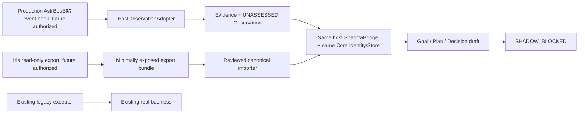

# Nana cloud integration: current facts and wiring boundary

[文档/历史实测] PROJECT_BRAIN/09_STATE.md、01_architecture.md记录生产奈奈运行于AstrBot 4.28.0，Iris记忆插件及独立B站进程。**本轮没有观察生产当前运行态**；服务器hostname、容器、实时版本/路径必须由下一次授权preflight确认。GitHub仓库不是正在运行的云端Core。开发Core在Codex /workspace/nana-core，基线d79fa3eb72efd1907d314780a5c8677bbc361021，263pass/1skip，E12 NOT_RUN。

| Entity | Current authority / future boundary |
|---|---|
| Production Nana | 原AstrBot/Iris/B站继续真实业务；本轮未接线或改动 |
| Development Nana Core | 独立Store/Identity/ActionKernel与合成实验；非生产实例 |
| GitHub repository | 工程事实、可控副本与版本保存，不是runtime或memory DB |
| Model providers | 可替换ModelPort，只提案，不拥有身份/授权/receipt；当前真实开发端点0 |
| Platform adapters | AstrBot/QQ/NapCat/B站提供Observation、legacy来源和Capability，不是第二Core |
| State authority | 当前生产Iris/各账本；未来受控canonical Core Store，阶段式迁移 |
| Execution authority | 当前旧系统。Core shadow永远无现实执行权；owner epoch仍复用S6 |

同宿主嵌入、单Store writer、串行有界任务；不长期运行两个完整自治Runtime。shadow DB独立于生产Iris DB，identity初始化/恢复由既有Store负责，不由模型重建。宿主只传递已筛选事件，不默认接所有私人聊天。出口STOP不可通过配置打开。

源码依据：src/nana_core/storage/sqlite_store.py Store.ingest/identity/transaction；actions.py ActionKernel；migration/routing.py OWNER_KEY/select_owner；migration/shadow.py ShadowObserver；migration/iris.py IrisAdapter；materials/iris_customizations/NEW_FILES/conversation_flow.py:297 append_event；src/bili_agent/bili_event_pump.py、bili_send_core.py。正式Iris字段依据docs/nana_core_phase3_iris_mapping.md及锁定source manifest；本次未复制AGPL执行代码。

契约：HostEvent保留platform/channel/sender/event/conversation/reply/附件reference/来源/原时间。Adapter只生成unrelated Observation，原envelope作为artifact；事件命名空间区分host/platform，稳定key包括conversation/event/revision。重复内容不是重复事件。缺失/坏时间UNKNOWN，不用接收时间补造发生时间；原事件聊天不是可信事实。附件不下载；raw_content_reference是opaque locator，不自动读文件。

## Read-only export and preflight (M2)
`integration/exporter.py`提供API/CLI `nana-iris-export`：必须显式选择已经一致备份的SQLite/JSON快照；SQLite `mode=ro&immutable=1`，拒绝未清理WAL/journal，固定memories/nodes/edges表。**不对活跃DB使用immutable，不运行Iris初始化代码**，不打开FAISS。L1/画像/流水/index_meta通过操作者提取的有界JSON envelope读取；不会假装自动理解所有原生磁盘wrapper。14类夹具中的11schema全可封装，实际磁盘reader仅上述固定表和JSON envelope。默认hash-only，redact逐字段最小白名单，include须未来明确授权且stdout敏感，不上传Git；弱口令/低熵文本hash不是匿名化保证。每条稳定legacy id/payload hash/source/version/type/time/relation/UNASSESSED，manifest有界8MiB/100条，无来源写。

`nana-cloud-preflight`只stat显式路径、读取包版本metadata/Python/SQLite、disk/当前进程和hostname hash。不会import插件、读配置、secret、聊天、DB，不安装/修复。当前Core要求Python>=3.12、SQLite>=3.51.3和Pydantic2.13.4；真实云端是否满足未知，若不满足BLOCKED，不擅自升级。未运行中的Iris版本/事件hook/快照一致性保留UNKNOWN；PASS不是自动获准部署。4 targeted passed，fixture DB逐字和目录列表未变化，dev预检UNKNOWN而不是宣称production ready。

## Shadow Bridge and reconciliation (M3)
`integration/shadow.py`复用Store/Artifact/Observation/CLAIM保存Goal/Plan/Decision **draft**。不创建活跃goal、不实例化Runtime/ActionKernel/可执行port，external_execute字段Literal[False]，任何execute恒SHADOW_BLOCKED；零现实预算、零Attempt/Grant/Strategy。直接调用ShadowCapabilityPort也拒绝。引用memory/evidence/experience必须在同一identity的Store真实存在。当前fixture decision可运行；real_model声明没有CallLedger绑定一律拒绝，不能伪造语义通过。真实ModelPort shadow wiring仍需授权端点后绑定账本，不影响纯shadow准备。

Export bundle manifest独立校验后以UNASSESSED Observation/Evidence接收；hash-only不变成原始正文或可采信事实。原synthetic IrisAdapter不放开production scope；真实include bundle canonical导入需未来显式数据范围核验，不在本轮偷改限制。

Reconciliation纯比较同一event的interpretation/memory/evidence/goal/decision/planned action，列重要历史遗漏、changed inputs与causal attribution UNKNOWN。差异不等于优劣；模型/经验/记忆改变仅列输入差异，因果需要既有matched ablation另证。当前legacy path是显式fixture，不冒充AstrBot真实判断。

[实测] 7 targeted passed；CLI实际Store关闭/重开、14条hash-only export→evidence→host observation→draft，重复source/event/decision幂等；identity一致、actions/attempts/budgets/grants/strategies/goals/plans均0。shadow_reconciliation.json/md。首次人类报告生成用了系统Python而无editable包，纠正为既有.venv Python；实现及测试未改断言。

## Execution and memory authority protocols (M4)
`ExecutionProtocol`只允许simulation_only，严格阶段 LEGACY_ACTIVE→SHADOW_CORE→CORE_READY→HANDOFF_PENDING→CORE_ACTIVE→ROLLBACK_PENDING→LEGACY_RESTORED。阶段只为迁移证据，唯一owner仍是S6 `migration.execution_owner`，持久epoch切换使旧bound port失效。HANDOFF_PENDING/ROLLBACK_PENDING在Router代码中阻断新dispatch，但允许当前owner独立verify未决；切owner与阶段记录之间崩溃产生epoch不匹配时fail-closed，可重新进行同一transition。Core_ACTIVE/恢复需Operator对象、同身份完整artifact及全部HandoffChecks；Router真实查询Core未完成actions/goals，UNKNOWN不视作完成。旧外部pending只能由未来独立清单对账提供attestation，模型不能提交Operator。

**当前没有停止真实legacy进程或跨生产executor fence的机制**，不能据模拟owner切换宣称生产互斥。真实切换前须另授权给旧所有发送入口加持久fencing epoch，证明无旁路，核对legacy pending/irreversible queue、冻结state+Grant+Budget。任一UNKNOWN/pending阻止切换，不能靠默认bool放行。rollback同样先阻止新Core dispatch、核验pending，再epoch++恢复旧方，禁止简单把两个配置都开。

Memory M0 Iris authoritative/writer Iris；M1 Iris writer+Core影子导入；M2 Iris writer+dual read；M3 Core canonical唯一writer，Iris只兼容读；M4 Core authoritative。Core导入写自己的派生影子DB不是production memory write authority。writer改变需fence attestation与独立对账artifact；MemoryAuthorityProtocol仅synthetic工程协议，不实际控制Iris写入口。冲突原证据保留、summary/inference仍UNASSESSED；M3/M4回滚必须把handoff后的新evidence补回受控只读兼容来源/恢复基线，不得删Core经历或让两个writer同时自由写。当前不实现生产catch-up执行。

Production capability目录见`integration/capabilities.py`：B站/AstrBot send/allowlist file-read/QQ-NapCat，每项version/read-write/scope/Grant/幂等/verify/UNKNOWN恢复/maturity。所有生产adapter执行禁用。B站旧源码bili_send_core.py:318–320将send回包称VERIFIED；这不是Core独立核验，必须标LEGACY_PARTIAL，未来需以list/作者/content/root/rpid独立证据MATCH才能升级。AstrBot补丁仅发送平台适配，不提供统一delivery证明，不能伪造VERIFIED。

[实测] M4旧S6+新protocol 30 passed，未决proposed action阻止换主，cancel后epoch1→2→rollback3，缺budget/snapshot等check阻止，memory writer翻转前必须证据+fence。首次测试导入错名FakeCapability，按真实FakeWorld修正后保留断言；不改旧用例。
