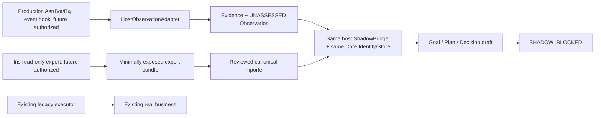

# Nana cloud integration: current facts and wiring boundary

[文档/历史实测] PROJECT_BRAIN/09_STATE.md、01_architecture.md记录生产奈奈运行于AstrBot 4.28.0，Iris记忆插件及独立B站进程。**本轮没有观察生产当前运行态**；服务器hostname、容器、实时版本/路径必须由下一次授权preflight确认。GitHub仓库不是正在运行的云端Core。开发Core在Codex /workspace/nana-core，基线d79fa3eb72efd1907d314780a5c8677bbc361021，263pass/1skip，E12 NOT_RUN。

| Entity | Current authority / future boundary |
|---|---|
| Production Nana | 原AstrBot/Iris/B站继续真实业务；本轮未接线或改动 |
| Development Nana Core | 独立Store/Identity/ActionKernel与合成实验；非生产实例 |
| GitHub repository | 工程事实、可控副本与版本保存，不是runtime或memory DB |
| Model providers | 可替换ModelPort，只提案，不拥有身份/授权/receipt；当前真实开发端点0 |
| Platform adapters | AstrBot/QQ/NapCat/B站提供Observation、legacy来源和Capability，不是第二Core |
| State authority | 当前生产Iris/各账本；未来受控canonical Core Store，阶段式迁移 |
| Execution authority | 当前旧系统。Core shadow永远无现实执行权；owner epoch仍复用S6 |

同宿主嵌入、单Store writer、串行有界任务；不长期运行两个完整自治Runtime。shadow DB独立于生产Iris DB，identity初始化/恢复由既有Store负责，不由模型重建。宿主只传递已筛选事件，不默认接所有私人聊天。出口STOP不可通过配置打开。

源码依据：src/nana_core/storage/sqlite_store.py Store.ingest/identity/transaction；actions.py ActionKernel；migration/routing.py OWNER_KEY/select_owner；migration/shadow.py ShadowObserver；migration/iris.py IrisAdapter；materials/iris_customizations/NEW_FILES/conversation_flow.py:297 append_event；src/bili_agent/bili_event_pump.py、bili_send_core.py。正式Iris字段依据docs/nana_core_phase3_iris_mapping.md及锁定source manifest；本次未复制AGPL执行代码。

契约：HostEvent保留platform/channel/sender/event/conversation/reply/附件reference/来源/原时间。Adapter只生成unrelated Observation，原envelope作为artifact；事件命名空间区分host/platform，稳定key包括conversation/event/revision。重复内容不是重复事件。缺失/坏时间UNKNOWN，不用接收时间补造发生时间；原事件聊天不是可信事实。附件不下载；raw_content_reference是opaque locator，不自动读文件。
