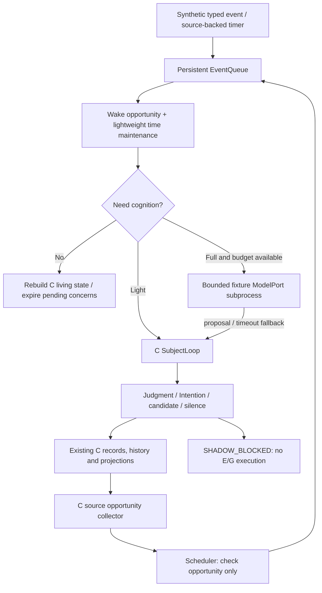

# D-V1 — Continuous Runtime & Persistent Presence

Status: IMPLEMENTED / TESTED in offline development. No real host qualification.
Base: `ea65dabaa907b8bd777723d5ccc9527e1014d0c5`. Contract:
[ADR-DV1-001](ADR/ADR-DV1-001-continuous-runtime.md).

D supplies persistent time and opportunities to the existing C subject. It does
not define personality, interests, social frequency or execution authority.
C-V2 + D-V1 is a foundation for Nana, not the complete future Nana.

## One path



No CuriosityLoop, SocialLoop, ReflectionLoop or ProjectLoop runs alongside C.
`background_opportunities()` is a C query; D persists its check schedule. Adding
a MotivationSource changes C interpretation if needed, not the Runtime loop.
Unknown sources can remain WATCH. Non-action, rest and silence are valid results.

## Responsibilities and state

| Component | Input → output | Persistence / failure |
|---|---|---|
| `NanaRuntime` | Config + canonical dev Store → bounded steps / health | Same Store; owns one lease; stops on loss |
| `RuntimeClock` | Injected UTC, monotonic elapsed, history/lease high-water → nondecreasing time | UTC deadlines survive process restart; no monotonic value reused across boots |
| `RuntimeLease` | Exclusive Store lock → instance, epoch, PID/start/boot fence | Pre-BEGIN and pre-COMMIT cognitive mutation checks; expired owner cannot renew |
| `EventQueue` | Strict `RuntimeEvent` + source causes → durable idempotent work | Active capacity, optional stream order, no discarded body; crash checks committed C cycle |
| `Scheduler` | Source-linked one-shot/deadline/periodic/condition check → event | Coalesces late periods; same scheduled occurrence resumes after crash |
| Wake manager contract | Nine typed triggers + event kind → time maintenance or cognition opportunity | Implemented by queue/scheduler + coordinator, not another autonomous agent |
| `CognitionCoordinator` | Appraisal/load/resource budget → NO/LIGHT/FULL | Persistent attempt ledger, cooldown/backoff, UNKNOWN never auto-retried |
| Supervised model resource | Frozen serialized C context → untrusted proposal | Fixed fixture argv, timeout, parent-death fence, kill/reap; no Store handle |
| `SubjectLoop` | Situation → appraisal/motivation/attention/judgment/intention | Existing C authority; source-backed concerns/norms/social variation/reflection |
| RuntimeHealth | Queue/lease/resource/checkpoint metadata → read view | Operational, never Self Memory |
| Synthetic perception | Supplied fictional observation → typed event | Screen/file/presence/platform fixture ports; no real sensing |

Event types: USER, TIME, WORLD, DEVICE, PLATFORM, PROJECT, RELATIONSHIP, GOAL,
SELF, REFLECTION, CAPABILITY. Wake triggers: INCOMING_EVENT, TIME_TRIGGER,
GOAL_TRIGGER, ANOMALY, RELATIONSHIP_TRIGGER, SELF_TRIGGER, REFLECTION_TRIGGER,
DEVICE_TRIGGER, ENVIRONMENT_CHANGE.

Queue: READY / DEFERRED → PROCESSING → DONE / IGNORED / EXPIRED. A source-key
collision fails. Stream sequence collisions fail; stale ordered work is ignored.
After crash a committed C cycle is acknowledged, not recomputed. A RESERVED
cognition call becomes UNKNOWN; a new attempt for that event is forbidden.
Cheap C policy can still finish uncommitted work without a new model call.

Time checks do not require model inference. Low-frequency review performs C
maintenance; current time affects derived recency/state. Specific commitments,
blocked projects, source-backed unresolved topics and checked experiences provide
bounded independent attention opportunities. Once-per-source/revision keys avoid
repeated social proposals. Source change can create a new opportunity.

## Authority and migration

Explicit development schema v8 adds **4 tables**: `runtime_lease`,
`runtime_queue`, `runtime_schedules`, `runtime_cognition_calls` (39 total with
existing C v7). `ContinuityStore` still defaults to v7, legacy `Store` to v1.
Only `NanaRuntime` or explicit `schema_target=8` opts in. No production Store is
upgraded. Existing privacy journal, erasure lineage, artifacts and replay remain
authoritative. Queue audit rows do not duplicate message bodies.

Single runtime authority is guaranteed for one canonical **local** Store using
its existing exclusive flock plus durable epoch/lease. A zombie holding the
lock blocks takeover. An expired/lost instance cannot commit C state. Official
backup/replay copies remain quarantined and cannot acquire a runtime lease.
This does not solve distributed partition failover, hostile root, NFS locking,
or independent privileged raw clones. Migration to another machine needs a
separate stop/copy/verify/activation protocol; two writable copies are forbidden.

Before opting an existing dev v7 Store into v8, retain a controlled backup and
the original source checkpoint. No automatic v8→v7 downgrade exists. Stop the
new runtime before rollback; restore a pre-upgrade snapshot in quarantine for
inspection. Never make an old backup a second active subject. A deployment or
quarantine release protocol is outside this candidate.

## Development CLI

Requirements for this candidate: Linux local filesystem, CPython >=3.12,
SQLite >=3.51.3, existing project dependencies. Verified here on CPython3.12.14,
SQLite3.53.1, Pydantic2.13.4. No AstrBot, GUI, phone, network provider or secrets.

From this checkout with the existing dev environment:

```sh
.venv/bin/python -m nana_core.presence.cli init-synthetic --db .nana-experiment/standalone-dev/self.db
.venv/bin/python -m nana_core.presence.cli run --db .nana-experiment/standalone-dev/self.db --max-seconds 30
.venv/bin/python -m nana_core.presence.cli status --db .nana-experiment/standalone-dev/self.db
```

`run` is a foreground process, not a daemon or startup registration. In another
terminal, `stop --db <same-path>` requests SIGTERM only through a pidfd after
checking the exact PID/start/boot identity and CLI owner. Already stopped is a
no-op. Embedded Python owners shut down through their own `runtime.stop()`.
SIGINT/SIGTERM finish the current bounded step then checkpoint/release/close.
SIGKILL relies on transactional recovery at the next startup.

Optional `--config <json-path>` accepts the strict synthetic-only RuntimeConfig.
Default: no model, max8 calls/day, 10min cooldown, 30min failure backoff, 1.5s
model timeout, 256 active events, 128 active schedules, 6h review, 4h idle recall,
30s lease /5s heartbeat. Config contains no credentials. Available model names
are registered fixtures only; there is no arbitrary endpoint/command setting.
Use `--max-seconds 0` only for an explicitly supervised foreground dev session;
it does not install any persistence into the host.

Python API: construct `NanaRuntime(path, config, clock=...)` as a context manager;
`submit(RuntimeEvent)` / `step()` / bounded `drain()`; `living()` is derived C
state; `health()` is operational. Source facts must be admitted through the
existing C services under the live lease. Runtime never receives a raw host
event object. Standalone fixture creation fails if destination already exists.

Status separates PID existence, active lease and heartbeat freshness. A stopped
runtime embedded in a still-live Python process is not an active owner. Clock
uncertainty/stale heartbeat is explicit; health is not evidence of real safety
or model semantic quality.

## C extensions and limits

Generic ConcernCue supplies a source-backed topic, optional affordances,
availability/load and scope constraints; it is not an adopted intention. C
interprets open MotivationSource names and applies duty/norm/privacy/load
inhibition. Creative preference dependencies require a currently adopted
evidence-supported assertion. No cue grants permission or writes identity.

SocialInteractionProposal has semantic act/approach/topic/source/lesson IDs,
`utterance=None`, delivery authority false. Positive fictional feedback must
bind a real prior C proposal and independently checked result. The existing
Experience→Reflection→lesson trial→operator activation path provides bounded
contextual variation; suspending the lesson changes the future proposal.
Reflection is not automatic authority to activate a lesson or to invent success.

The synthetic read port looks up an explicitly supplied dictionary under an
exact synthetic delegation snapshot. It never opens a host path. Password,
credential, payment, other-person-secret and unknown resources are denied.
It returns a fictional observation, not an Action receipt or production success.

The initial C policy uses ordinal source annotations and a small interpretation
registry. This demonstrates causal engineering structure, not human subjective
experience or general real-model cognition. Real endpoint recovery/reconciliation,
E goal adoption/actual execution, G sensing, natural language generation and
standing-delegation activation are not enabled. Cold audit history grows;
only active queue/schedule/context/call budgets are bounded. Long-term archive
and distributed migration remain future work.

## Qualification

```sh
.venv/bin/python -m nana_core.presence.qualification --output .nana-experiment/new-runtime-check --with-process
.venv/bin/python -m pytest -q tests
```

Output path must be new. The first command uses synthetic dev Stores and actual
local child processes, never real hosts/models. It writes a detailed results.json.
Its scenario matrix deliberately treats S1 curiosity as one case among S2 duty,
S3 capability gap, S4 creative history, S5 silence, S6 norm inhibition, S7 rest,
S8 learning, S9 independent opinion, S10 world events. Runtime sees none of the
case IDs. Expected outputs remain in qualification code, not runtime code.

Permanent measurements, limitations and regression are in
[delivery](nana_continuous_runtime_delivery.md) and
`nana_continuous_runtime_evidence/`. Actual local process results do not upgrade
real AstrBot binding, first real Shadow, real memory ingress, E12 or production.
