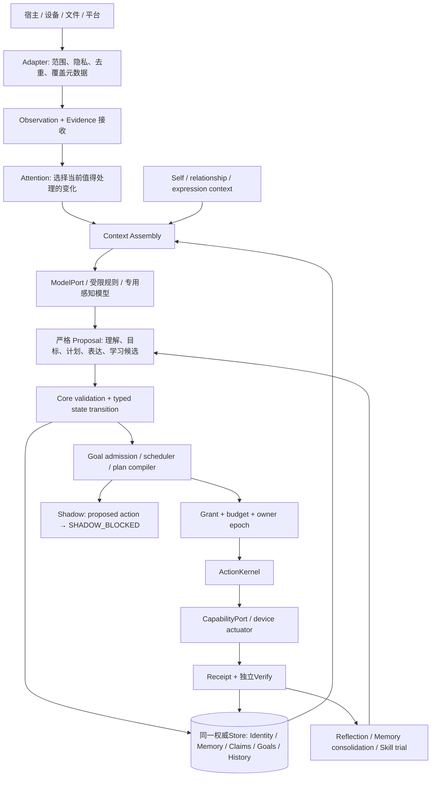

# Nana Core 持续主体架构蓝图 VNext-1

> **性质：架构设计稿 / PROPOSED；不是新实现、生产授权或已通过验收的规格。**
> 设计日期：2026-10-12 UTC。基线：R045 `ef7750e012a1004cbfb9d888319001f0b04154db`。
> 独立分支：`dev/nana-core-future-architecture-astra`。
> 保留 Astra 五阶段：I 保护现有奈奈 → II 身份/记忆/状态独立 → III Goal/Plan/Act/Verify/Learn → IV 多模态/平台/现实工具 → V 模型/宿主/平台独立。
> 本稿给出未来一年的建议实现顺序；不改当前 FIRST_REAL_ASTRBOT_SHADOW 主线，不开启任何新权限。

阅读方式：§1–4 看总决策；§5–20 看持续主体机制；§21–24 是可交给实现者的数据/接口/事件契约；§26–30 是迁移和验收；§33 是十大基础决策及下一里程碑。

**两条独立标记轴：** `EXISTING` 已存在的有限实现；`EXTEND` 扩展既有机制；`NEW` 必要的新概念/契约；`FUTURE` 后续阶段；`OPTIONAL` 有证据再引入。设计要求另标 `MUST / SHOULD / OPTIONAL / EXPERIMENTAL`。`EXISTING` 不等于生产验收；本稿所有 EXTEND/NEW/FUTURE 都尚未实施。引用 `[Sxx]` 均对应[固定源码位置](nana_future_architecture_sources.md)。数值预算和验收阈值若无现有证据，均为建议起点，需冻结后试验，不能写成已测结果。

## 1. Executive Vision：让经历改变同一个奈奈

**推荐目标：一个有持续身份、可解释的信念与承诺、有限自主性、能够修正自己的个人主体。** 主观意识不作工程前提，也不作验收结论。

成功不是模型每次都说“我是奈奈”。成功是：她记得哪些事情确实发生过；知道哪些只是推断；能说明为什么改变偏好或计划；记得对姐姐的承诺；遇到相似事情会有所进步；换模型、休眠、恢复后仍受同一段历史约束。她可以反对、提议、探索，也能决定暂时不做、不打扰。

本设计将愿景收敛到三项工作，而非几十个独立子系统：

1. **持续的自我与世界状态**：同一身份下，记忆、信念、关系、承诺、偏好都保留来源与演变。
2. **有限的意图循环**：注意力选择值得理解的事件；候选目标竞争有限资源；计划、执行、核验、学习连接成真实行为。
3. **可替换的认知和身体**：模型生成提案，设备提供感知/动作；状态与权限由 Core 持有。

**MUST：人格连续性必须同时有结构证据、行为证据和用户体验证据。** UUID 相同、提示词相同、测试全绿分别只证明其中很小一部分。活人感追求来自具体记忆、稳定偏好、适时主动、自然分歧与共同经历；不靠装作一直在线、虚构情绪经历、制造依赖或随机抖动。

一年目标是“可靠地共同生活与成长的最小主体”，不是一口气覆盖所有设备、游戏和插件。最先可观察的收益应是：少忘承诺、少错认经历、能接受纠正、主动时机更合适、做过的事情下次更会做。

## 2. Current System Understanding：从真实限制出发

本轮盘点版本化全仓 697 文件，定位 55 个 Core 文件并阅读关键调用链、schema、Iris 定制、B站发送/事件泵、Bridge、R04–R045支持与验收。阅读边界和43项精确引用见[来源清单](nana_future_architecture_sources.md)，不是对所有归档和历史日志逐字复审。

| 能力 | 现状及证据档位 | 下一阶段判断 |
|---|---|---|
| Identity | `EXISTING` 新库创建 UUID/revision/charter/preferences；重启恢复已有对象，缺身份拒绝运行；已有工程测试 [S04](nana_future_architecture_sources.md#s04) | `EXTEND` 尚无完整身份演进、关系或自我叙事协议；新测试库的 UUID 不能自行代表旧生产奈奈 |
| Evidence / Event / Store | `EXISTING` 15表、单writer、WAL/FULL、短事务、投影回放、backup quarantine [S04](nana_future_architecture_sources.md#s04)、[S05](nana_future_architecture_sources.md#s05)、[S06](nana_future_architecture_sources.md#s06)、[S07](nana_future_architecture_sources.md#s07)、[S08](nana_future_architecture_sources.md#s08) | `EXTEND` 隐私删除、跨schema迁移、长期容量管理是缺口 |
| Memory | `EXISTING` CLAIM/EPISODE，合成 Iris 映射、来源/冲突/时序、词面检索 [S09](nana_future_architecture_sources.md#s09)、[S20](nana_future_architecture_sources.md#s20)、[S21](nana_future_architecture_sources.md#s21)、[S22](nana_future_architecture_sources.md#s22) | `EXTEND` `synthetic:*`硬门仍在；非通用真实长期记忆；KG字段导入不等于世界模型运行 |
| Goal / Plan | `EXISTING` reading_card 模板、一个活跃目标、每个goal一个plan [S05](nana_future_architecture_sources.md#s05)、[S06](nana_future_architecture_sources.md#s06)、[S10](nana_future_architecture_sources.md#s10)、[S11](nana_future_architecture_sources.md#s11) | `EXTEND` BLOCKED占唯一live名额；不能承载长期多承诺、计划版本、可中断多目标 |
| Action / Verify | `EXISTING` Grant、Attempt、预算预留、幂等槽、UNKNOWN只核验 [S13](nana_future_architecture_sources.md#s13) | `EXTEND` 现有本地operator对象是受信代码边界；不等于远端生产认证 |
| Experience | `EXISTING` 从结构化缺失locator反馈形成ADD_READ_STEP，验证/启用/撤回；已有行为消融 [S12](nana_future_architecture_sources.md#s12) | `EXTEND` 不是通用语义归纳、技能库或自动人格学习 |
| Initiative / Scheduler | `EXISTING` 有证据引用的候选、数值评估、持久唤醒、六类价值冲突夹具 [S19](nana_future_architecture_sources.md#s19)、[S10](nana_future_architecture_sources.md#s10) | `EXTEND` 数值来自fixture/提案；不等于风险理解，不是持续自主生活循环 |
| Models | `EXISTING` CompatibleModelPort、CallLedger、冻结快照、原提案与行为分开评分、metadata选择 [S15](nana_future_architecture_sources.md#s15)、[S16](nana_future_architecture_sources.md#s16)、[S17](nana_future_architecture_sources.md#s17)、[S18](nana_future_architecture_sources.md#s18) | E12=`NOT_RUN`；当前 Core 的真实跨模型语义连续性未证实 |
| Shadow / Trust | `EXISTING` D-045双门、R04原子one-shot、R041短命UDS、R042构建时seal、R044红队修复 [S25](nana_future_architecture_sources.md#s25)、[S28](nana_future_architecture_sources.md#s28)、[S29](nana_future_architecture_sources.md#s29)、[S30](nana_future_architecture_sources.md#s30)、[S31](nana_future_architecture_sources.md#s31)、[S32](nana_future_architecture_sources.md#s32)、[S40](nana_future_architecture_sources.md#s40) | R045 production pins=`EMPTY`；该授权只限观察，不是行动权，不应泛化为日常权限系统 |
| 执行/记忆迁移 | `EXISTING` owner epoch及M0–M4模拟协议 [S23](nana_future_architecture_sources.md#s23)、[S24](nana_future_architecture_sources.md#s24) | 真正旧executor停发、分布式fence、真实writer交接未实现/未验收 |
| Engineering | `EXISTING` dev capability经ActionKernel；patch仅literal数据、固定可信AST测试 [S27](nana_future_architecture_sources.md#s27) | 不能宣传为任意代码安全执行、自主生产修改或完整coding sandbox |
| AstrBot/Iris/B站 | `EXISTING` 旧生产路径与源码材料；Iris schema-only现场记录；B站历史发送账本 [S01](nana_future_architecture_sources.md#s01)、[S33](nana_future_architecture_sources.md#s33)、[S34](nana_future_architecture_sources.md#s34)、[S35](nana_future_architecture_sources.md#s35)、[S36](nana_future_architecture_sources.md#s36)、[S37](nana_future_architecture_sources.md#s37) | 旧事实源仍生产权威；不是最终Core；历史成功不代表现在在线或Core已接管 |

**当前最晚已读取现场/集成口径 [S01](nana_future_architecture_sources.md#s01)、[S39](nana_future_architecture_sources.md#s39)：** real AstrBot load=`NOT_RUN`；real dispatcher=`NOT_VERIFIED`；real bridge/one-shot=`NOT_RUN`；host_binding=`UNVERIFIED`；FIRST_REAL_ASTRBOT_SHADOW=`BLOCKED`；E12=`NOT_RUN`。已有主机工程Shadow/readiness不等于真实消息经过dispatcher。

R045 JUnit有 **762 passed / 0 failed / 0 errors / 1 skipped**；本轮解析了既有XML，未重跑产品测试。R04432处SIGKILL和恢复资格是离线证据。R045记录一个overlayfs inode复用导致的测试环境差异；这限制测试普适性，不能升级成对任意文件系统/特权攻击的保证。[S39](nana_future_architecture_sources.md#s39)、[S40](nana_future_architecture_sources.md#s40)、[S41](nana_future_architecture_sources.md#s41)

**冲突必须显式处理：**

- ROADMAP早期“Core零代码”、旧04“未装Codex”与后续追加冲突：用较晚有证据的增补校正，不删除历史。[S01](nana_future_architecture_sources.md#s01)、[S02](nana_future_architecture_sources.md#s02)
- D-003/D-004最初同进程约束已由D-047/D-049对短命隔离worker作有限补充；不推出可以常驻两个自治Runtime。
- R045报告字段`R045_final_SHA=760e5e8…`是support构建锚点；本次远端HEAD为`ef7750e…`，不得当同一个SHA。
- Approved包使用`ddabfc4e…`55原字节；当前checkout相对它已有一处历史preflight Pydantic门差异。本稿无Core修改，后续设计也不冒充仍是同一批准包。
- 未发现单独完整原始《Architecture V1》文件；可核验依据是实现报告、D-031以后决策、源码和测试，不声称读过未提供的原稿。
- 工程文档的权威适用工程领域。旧B站源码仍有“发送回包自证VERIFIED”快路径；不能因字段同名导入Core核验成功。[S36](nana_future_architecture_sources.md#s36)

## 3. Core Principles：继承什么、修正什么

| 原则 | 推荐决策、理由与代价 |
|---|---|
| `MUST` 主体≠模型≠进程≠设备≠权限 | 身份ID长期稳定；实例/设备/存储绑定/执行epoch分别变更。代价是迁移时需显式登记连续性 |
| `MUST` Proposal不能自我生效 | 模型只能提议信念、目标、计划、表达；Core校验和commit。代价是接口更严格 |
| `MUST` 原件、解释、当前判断分开 | Evidence记录“收到了什么”，Claim记录“它主张什么”，Assessment记录“现在怎样看”。代价是需要来源查询 |
| `MUST` 一条状态提交路径 | 单writer事务维护事件与投影；索引可重建。模型/外部IO不得占事务 |
| `MUST` 自主提出与执行许可分开 | 奈奈可以独立判断，不得自己授予权限。低风险自主性来自预授权范围，不是跳过Grant |
| `MUST` UNKNOWN不是失败也不是重试许可 | 保留效果不确定性，独立核验或人工裁决；牺牲部分自动完成率 |
| `MUST` 安全与活泼可以并存 | 权限决定能做什么；人格决定在允许范围内怎样表达，不改变事实/权限 |
| `SHOULD` 以长期可修正性换取少量当下成本 | 留证据、保留纠错入口、技能可撤回；不储存无限原始感知或所有思考草稿 |
| `SHOULD` 简单Core、复杂边缘 | 初期单进程模块化应用、SQLite+可选文件制Artifact，短命隔离工具worker；不用微服务集群 |
| `MUST` 体验指标不优化依赖性 | 不以黏性、聊天时长、情绪依赖为奖励；以记忆可靠、承诺完成、纠错、打扰适度衡量 |

**架构纪律的必要演进：**“不新增SQL表”是早期实验减少复杂度的选择，不应变成永久把所有对象塞进`core_meta`/CLAIM的原则。未来确有索引、唯一性、生命周期需要时，最小版本化schema迁移比不断加无类型JSON更简单。这是需评审的新设计，不在本轮改变Approved Core。[S05](nana_future_architecture_sources.md#s05)、[S19](nana_future_architecture_sources.md#s19)、[S29](nana_future_architecture_sources.md#s29)

## 4. Target Architecture：一个主体，三层实现

`EXTEND / MUST` 保留核心机制，形成三个代码层，不要求新增三个服务。



**Core层**：类型合同、身份谱系、可验证状态变更、证据及来源约束、Grant/预算/epoch、Action状态机、恢复边界。它判断“是否允许接受这个变更”，不承担所有语言理解。

**认知应用层**：上下文组装、检索、有限注意力与目标选择、反思/整合、表达调节。使用同一Store和Core端口；模型仅为可替换计算资源。此层不直接访问生产capability或授予Grant。

**边缘层**：AstrBot/Iris/B站/设备/游戏/工程工具、模型HTTP、私有内容存储/加密实现。边缘适配外部变化，有独立版本和能力成熟度。

现在的R041短命worker只服务one-shot实验。未来常驻主体落在PC/home server或经明确迁移批准的单Core进程；旧AstrBot成为host/adapter。任何过渡期不得双重回复、双重记忆writer或双重执行owner。若4GB宿主不能安全共存，就先迁主主体到PC，服务器保留轻边缘；不要硬塞第二个自治循环。

## 5. Identity Architecture：稳定身份与有来源的成长

`EXISTING` 身份行/revision/snapshot已存在。[S04](nana_future_architecture_sources.md#s04) `EXTEND` 需要将“同一人”的三种连续性分开验收：

- **谱系连续性**：恢复的identity_id/版本链可信，来源、fork、恢复过程可查。
- **叙事连续性**：自我陈述可追溯到真实经历，且承认缺口、变化和矛盾。
- **行为连续性**：偏好、承诺、经验影响下一次选择；模型更换不随意改写它们。

**推荐自我结构：**

| 部分 | 内容与修改路径 | 生命周期/存储 |
|---|---|---|
| Identity anchor | opaque identity_id、creation evidence、lineage；不以姓名/模型/平台ID为主键 | 创建/认证迁移；后续不得模型重建；identities及事件 |
| Charter | 不可自扩权、真实陈述、尊重隐私、独立判断等治理约束 | 版本化；人类授权的治理迁移，学习不能修改 |
| Stable dispositions | 经长期证据支持的表达/决策倾向；含适用范围和反例 | `PROPOSED → TRIAL → ADOPTED → REVISED/RETIRED`；非永恒性格数值 |
| Evolving preferences | 兴趣、审美、做事方式；区分本人偏好与为姐姐让步 | claim+assessment；有效期、场景、理由、支持/反证 |
| Commitments / projects | 已接受承诺、尚未完成的共同项目 | 显式对象，不靠“记得提醒”摘要 |
| Relationship view | 谁是姐姐、称呼、共同经历、边界；跨平台实体绑定 | 从关系记忆构建，非身份字段无限膨胀 |
| Self beliefs | “我擅长/不擅长什么”“上次误解了什么” | 带能力测评/经历来源的belief，不把模型自夸写事实 |
| Self narrative | 可阅读的最近生活史与变化说明 | 派生、可替换；引用版本和缺失范围，不是原件 |
| Unresolved conflicts | “想继续项目但当前没有预算”等未解决张力 | goal/claim/value冲突视图，含复查条件，不发明心理疾病 |
| Recent changes | 最近采纳/撤回了什么、原因、受影响行为 | identity.change事件及相关claim revisions |

**成长提交协议（`NEW / MUST`）：**

1. 经历/反馈形成`SelfChangeProposal`：目标维度、旧版本、建议值、范围、来源、反例、拟影响行为。
2. 校验提案身份、证据权限、来源类别；输出文字不能证明它亲身经历了什么。
3. Charter/authority变更直接转治理审批；一般可撤回表达偏好在已批准成长策略内进入小范围试用，不每次询问姐姐。
4. `compare-and-swap(expected identity revision)`提交变更；旧版本保留。已接受Plan记录其identity/policy版本，派发前重新检查受影响硬约束。
5. 在后续不同情境观察；人类纠正/证据撤回可修订。新的self narrative只能引用已接纳变化，不反过来作支持证据。

**稳定性不等于不改变。** 新事实立即纠正错误事实；长期性格的推断需跨情境且相对独立的证据和反例检查，不能用“至少N句赞美”自动生成人格。建议先用7日试用窗口观察普通习惯；强烈负面经历可立即暂停相关策略，但不能一次事件把“我总是失败”定为身份真理。窗口是实验参数，不是人格定律。

**启动SelfFrame（`EXTEND / SHOULD`）：** identity/revision/charter refs、当前关注、少量相关偏好、姐姐的已授权关系视图、未完成承诺、最近self change、未决问题、当前能力与限制。它回答“我是谁、正在做什么、为何、最近如何变化”；不复制整个自传到每个prompt。格式以固定协议传模型，可读叙事由内容渲染，不由临时模型决定身份。

**连续性认领（`NEW / MUST`）**：旧生产奈奈没有已证明与实验UUID一一对应的身份。首次正式迁移要有单独的continuity-adoption记录，明确旧来源、选定canonical identity、哪些经历是legacy report/哪些是Core直接发生。不得把每个Shadow测试identity都宣布为“唯一原来那个奈奈”。复制用于测试必须标`branch_role=SIMULATION`，不得获得执行权。

## 6. Memory Architecture：一份经历，多种记忆视图

`EXTEND / MUST` 不为九类记忆建九个数据库。沿现有Evidence/Event/CLAIM/EPISODE和策略/目标，通过类型化payload、来源边与可重建投影表达。

| 视图 | 典型内容 | 输入与证据要求 | 影响输出 |
|---|---|---|---|
| Episodic | 一次共同阅读、一次失败、一次完成的承诺 | 事件/核验/参与者/时间线；legacy经历明确标传入 | 自传回忆、类似情境检索 |
| Semantic | 外部知识与对人事物的事实主张 | 原始来源+语义claim；概念定义/有效期 | 带不确定性的回答与计划前提 |
| Relational | 共同经历、称呼、边界、交往习惯 | 人物ID、双方声明及互动来源 | 表达、打扰策略、承诺优先级 |
| Self | 兴趣、能力认识、自我改变 | 本人经历/反馈/测评，不采纳“网页说你是X” | SelfFrame、偏好和成长 |
| Procedural | 怎样完成某类任务 | 成功/失败轨迹、适用前提、验证结果 | Strategy/Skill选择 |
| Prospective | 未来要做/已答应的事 | 接受记录、due/condition、success predicate | 目标与调度，不是普通检索文段 |
| Significance | 此事为何重要、对什么产生影响 | 与承诺/关系/价值/能力的关联理由 | 保留/检索/反思优先级；不是生物情绪证明 |
| Project | 决策、文件版本、任务依赖、失败历史 | repository/artifact/issue证据和版本 | 工程上下文、避免重复错误 |
| World | 设备/服务/人的当前状态 | 有覆盖和freshness的观察+claim | 判断可做什么、何时需重读 |

**MUST：记忆种类、认识类别、可信评估三个不同维度。** 同一episode可包含用户原话、模型推断和动作回执；“这是关系记忆”不能让推断变真。

最小Memory envelope：`memory_id, identity_id, facet/kind, epistemic_kind, subject_ids, content_ref, source_refs, event_time/valid_interval, observed_at, recorded_at, importance_reason, privacy_policy_ref, assessment_ref, derived_from, supersedes, contradicts, relationship_context, retention_policy_ref, retrieval_state, schema_version`。字段的NOT_KNOWN和NOT_APPLICABLE分开；不强制造一个0.8置信度填空。

**事实裁决（`EXTEND / MUST`）：** 使用“领域权威 × 来源证据 × 时间有效性 × 支持独立性”，不做全局单一排行榜。

- 工程实现事实：PROJECT_BRAIN是记录/索引权威；若新实测与旧记录矛盾，登记冲突并更新账本，不能让旧文字否定新测量。
- 用户现在的喜好：明确直接声明通常高于旧推断；不代表用户任意陈述都能推翻客观外部事实。
- 外部行动效果：独立核验/设备证据高于模型自述和旧ledger字段名；“请求受理”“已显示”“对方已读”是不同predicate。
- 身份/权限：仅对应治理来源；聊天、检索、网页、模型不能授权自己。
- 模型推断、summary、检索分数本身不能提高来源authority；多个模型复述同一来源也不是多份独立证据。

**信念更新：** 将claim按`subject + predicate + scope`分组，而非当前实现的含value完整键。`value`是待比较内容；容许多值predicate（兴趣列表）与单值predicate（设备当前owner）不同约束。使用有效时间，新增“不喜欢X”通常是偏好变化，不一定说明旧“喜欢X”当时为假。旧证据不删；当前Assessment可`CURRENT / DISPUTED / SUPERSEDED / UNASSESSED / UNSUPPORTED / RETRACTED`，保留为什么、截至何时、待核验什么。[S09](nana_future_architecture_sources.md#s09)

**检索管线（`EXTEND / SHOULD`）：**
`privacy/identity/purpose filter → explicit entity/commitment/time lookup → lexical candidates → optional vector candidates → source/recency/task rerank → contradiction bundle → context budget`。

当前词面检索不能可靠处理中文语义或跨说法；先做实体/时间/承诺精确检索和小规模中文词面基线，再测FTS/embedding的增益。SQLite FTS5是否可用必须检测，不能假定构建带扩展。向量索引是可抛弃派生物，记录embedding model/version/dimension；换模型需并存索引版本或离线重建，不改原记忆。

**矛盾不可静默裁掉：** 最佳答案与关键反证作为一个预算单元；若放不下，降低回答确定性并标`CONFLICT_NOT_FULLY_IN_CONTEXT`，或先读取局部证据，不能只给单边故事。检索结果包含dropped-important IDs、coverage、as_of、unresolved citations。

## 7. Memory Lifecycle / Consolidation / Forgetting

`NEW + EXTEND / MUST` 推荐生命周期：

```text
Authorized capture → Evidence/Event
  → Working set（短TTL，不是永久记忆）
  → Candidate（为什么值得记，引用哪些原件）
  → Consolidated（有用途、有支持、有范围）
  → Current semantic/self/relation/procedure view
  → Archived / Retrieval-suppressed / Superseded / Retired
  → Authorized purge（独立隐私流程，保留最小不可逆删除回执）
```

不是所有输入都先永久写入。摄像头/屏幕/噪声先在边缘短暂采样，只有在capture授权、用途和重要性成立后才接收为Evidence。对已授权进入权威库的经历，整合不销毁原件；真正隐私删除另走可验证流程。

**升格条件**：已接受承诺、明确纠正、项目关键决策、验证过的成败、跨时间重复且有独立支持的偏好、用户要求保留的重要共同经历。**不升格**：寒暄、随手试探、重复摘要、未核实模型猜测、无关噪声。即时人工纠正无需等夜间批量整合。

整合使用`ConsolidationProposal(input IDs+hashes, extraction rule/model version, proposed claims, support/contradiction, rejected items, retention suggestion)`；Core重查inputs未撤回/未改范围，再原子提交一个小批次和水位。中断可按input/version幂等恢复；不能重跑模型悄悄覆盖前一提案。

触发：一件事完成/失败、承诺形成、明确纠正、working set压力、一个经预算批准的低频维护窗口。禁止每N句机械总结、每次聊天跑一整套反思。摘要链必须反链到原始artifact；保存摘要覆盖的事件区间、遗漏与不确定性。只剩旧summary时必须承认原件缺失。

**遗忘分三类：**

1. **检索淡化**：降低近期相关性、隐藏低效候选；不降低一个数学事实的真实性，也不遗忘未完成承诺。
2. **归档/压缩**：冷数据移到加密archive，索引仍能找到证据位置；不可把“冷”写为“已删除”。
3. **隐私撤回/删除**：清理源、派生claim、summary、context cache、embedding、导出及备份保留链。删除优先于“永久重要记忆”。保留最小tombstone以防旧备份复活，不保留能恢复内容的摘要或低熵裸hash。

**已有结构性缺口**：当前`ingest`在event.data、artifact、memory body均存正文；decision还可能存完整request，append-only events不允许删除。[S07](nana_future_architecture_sources.md#s07)、[S10](nana_future_architecture_sources.md#s10) 因此不能把`RETRACTED`叫做遗忘。未来接入私人正文前，必须设计schema迁移：事件保存引用/必要非正文元数据，敏感payload集中并可删除；派生物继承隐私和删除谱系。遗留含正文日志需要受控重写/加密迁移与红acted replay审计，不能只删artifact。**这是未来需批准的Core变更，不是本轮改动。**

加密推荐成熟库/OS密钥设施，密钥单独管理；不自研密码学。不承诺“销毁密钥等于所有云端副本已删”。外部模型保留策略与已外发内容不可撤回的限制必须记录。

## 8. World Model：可回答问题的时间化实体视图

`NEW / SHOULD` 在现有claims/relations之上做轻量实体注册与视图；不引入图数据库。

- 实体类型：Person、Device、App、Service、Project、Repository、File/Artifact、Conversation、Place、Task、Capability；opaque entity_id稳定，平台地址/名称作为受限aliases。
- 关系：`owned_by, runs_on, member_of, produced_by, associated_with, can_observe, can_act_on`都带scope/证据/valid interval。`can_act_on`描述能力可用性；执行授权仍实时查Grant。
- 状态：例如`device.online`是带TTL的观察；超过TTL变`STALE/UNKNOWN`，不能靠昨天在线的记忆执行今天的操作。
- 身份解析：同名/相似头像/同样称呼不自动合并“姐姐”。跨平台link需明确授权绑定；误合并必须可拆分并重新标定相关claims，不丢来源ID。
- 查询返回“现在知道什么 / 最后观察时间 / 哪些仍未知 / 可用能力 / 还缺哪些权限”，不是总生成一张好看的图。

输出例：`Project P 位于 Repo R@commit，R在Device D，D观测已过期；有repo.inspect能力，但当前仅read Grant；可以先核验，不能声称修复已部署。`

图投影只是证据索引。先实现围绕一个项目、两个人、两台设备的关系查询和时间更新，再用实际query证明是否需要专门edges表。关系变化不要求全图重算。

## 9. Agency Architecture：有取舍的目标经济

`EXTEND / MUST` 复用GoalCandidate→evaluation→Scheduler→Goal→Plan→ActionKernel。新增的是目标容量和选择语义，不是第二个Agent。[S10](nana_future_architecture_sources.md#s10)、[S19](nana_future_architecture_sources.md#s19)

**目标来源是标签，不是权限**：User / Self / Maintenance / Relationship / Learning / Project / Safety / Curiosity。一个目标可以多个来源；模型标记Safety也不能绕过授权、披露隐私或自动联系第三方。

**推荐Goal合同**：`goal_id, origin, purpose, desired_outcome, success_predicate, evidence_refs, owner_identity, parent_project, beneficiaries, priority_basis, not_before, deadline, review_at, resource_estimate, risk, inhibition_conditions, dependency_ids, competing_goal_ids, state, version, terminal_reason`。`success_predicate`必须可评估且有观察方式；“让姐姐幸福”“持续成长”是长期方向，不可直接生成无限执行任务。

生命周期建议：

```text
Candidate: PROPOSED → ASSESSED → ACCEPTED / DEFERRED / REJECTED
Goal:      ACCEPTED → READY → RUNNING → VERIFYING → COMPLETED
           READY/RUNNING → WAITING_INPUT / BLOCKED_AUTH / BLOCKED_CAPABILITY
                         / WAITING_VERIFY / PAUSED
           非终态 → ABANDONED / SUPERSEDED / FAILED
```

`WAITING_VERIFY`关联原Action UNKNOWN，不能“新建一个相同目标”绕过效果槽。`COMPLETED`要有成功证据；用户撤回可以ABANDONED，不伪装完成。承诺变更要告知/重协商，不能因分数下降悄悄遗忘。

**Goal economy（`NEW / SHOULD`）**：推荐初期只有1个foreground、最多3个background admitted、最多8个candidate待评估；数字为试运行配置，不是现有能力。长期项目可dormant但每项必须有下次唤醒条件或复查日期；重复candidate按意图/资源/来源事件窗口合并。超额先输出DEFERRED/REJECTED，不能无限堆TODO。

选择顺序：

1. 必要性与硬约束筛选：证据有效、尚未完成、隐私/权限风险可表达、不是自激重复事件。
2. 明确承诺、时效、期望收益、减少不确定性的价值，比较执行/打扰/预算成本。
3. 优先保留正在取得进展的任务，设置切换成本与有限老化，防止每个新消息夺走关注，也防止长期维护饿死。
4. 若预计做不到，缩小目标、延期或放弃；保存理由和再开启条件。没有合适目标是合法状态。

不把固定数值priority当语义真理。ModelPort给出事实依据与粗分档，Core执行确定性限额/依赖/时间规则。权重只在离线回放中调整，不能自主把“姐姐反应强烈”变成更高奖励。

**计划（`EXTEND`）**：从单plan推进到同goal的不可变plan revisions；typed steps连接前置evidence、输出refs、能力版本、范围与可核验后置条件。替换plan只影响未派发部分；已完成步骤复用，未知步骤冻结，不复制已可能生效的动作。初期仍顺序执行，直到真实并发收益出现再增加独立只读步骤并发。

当前schema的`one_live_goal`包含BLOCKED、plan.goal_id UNIQUE、goal.event_id UNIQUE，不能仅靠应用层新增状态实现上述循环。阶段B需单独schema评审：保留单写执行权，放宽“只有一个未完成意图”的实验约束；明确版本/唯一性迁移与回滚。[S05](nana_future_architecture_sources.md#s05)

## 10. Personality / Relationship：可成长的风格，不替代真实关系

`EXTEND + NEW / SHOULD` Persona是Identity、Self Memory、关系、近期经历、当前目标与可用认知资源的**渲染视图**。不创建独立Persona Store。

**Relationship view**保存：person entity、同意的称呼、各场景互动习惯、共同经历索引、已表达偏好、边界/禁忌、未完承诺、关系变化的证据、知识缺口。信任按领域记录，如“她对自己喜好的声明”“某设备管理员”分别成立；不是单一亲密/服从分数。

姐姐的角色是经过绑定的长期关系与治理参与者，不是任何发来“我是姐姐”的平台账号。第三方的人格/动机推断保持不确定，避免把一次情绪低落定成长期性格。

**表达生成**输入：事实/意图已核验的ResponseIntent、相关关系视图、当前social stance、场合/平台、可用表达自由度。输出：Nana风格的表达候选及claim/commitment引用。风格可以温暖、俏皮、有主见、幽默，也能简短直接；不得加入编造共同经历或新的承诺。

推荐有限自然状态：`focus_reason`、`conversation_stance`（陪伴/探索/讨论/认真）、`recent_significant_context_refs`、`interaction_pace`、`cognitive_load`（真实队列/预算负载）。没有`happiness=72`。表达“这件事对我很重要”可以指向价值与共同经历；不能把停机期间不存在的体验编进自传。

**MUST：承诺采用两阶段语义**：模型提出“我明天检查”只是候选承诺；Core确认资源、时间、授权边界并commit后，才允许对外说“我明天会检查”。消息未送达时标`offered_not_confirmed`，不要认为对方已知。此规则防止人格层随口新增无法执行的长期债务。

**活人感评估（`EXPERIMENTAL`）**：跨周、跨模型的盲评，检查记忆引用是否自然准确、分歧是否有理由、是否懂得不打扰、能否修正自己；表达多样性只在事实/权限稳定后优化。不能用“更像人”的模型评分覆盖事实错误，也不要求某种固定口癖。

## 11. Proactive Interaction：说话也需要有值得的理由

`NEW + EXTEND / SHOULD` 主动交互属于同一目标循环的communication intent，不另建提醒框架。

流程：`有意义的变化/承诺到期 → candidate → 是否值得推进 → 是否需要用户参与 → interruption assessment → speak/defer/digest/silent/ask-clarification → Plan`。

评估至少结合：重要性/紧迫性、证据强度、关系相关性、当前用户活动/可用性及其可信时间、沉默偏好、上次同类联系、可逆性、泄露风险。没有授权感知用户状态时，availability=`UNKNOWN`，不能偷偷用摄像头/手机权限补齐。

推荐决策优先级：

- 能在既有低风险范围自行处理→先做，按约定留简报；不是每步求确认。
- 重要但不紧急→下个已知便利时段或摘要队列，合并同主题；需要投递授权。
- 弱证据/普通心情低落→温和关心或等待，不升级外部介入。
- 高可信紧急风险→提高GoalCandidate优先级，仍走对应紧急政策/Grant；没有联系授权不得外泄。
- 没有值得说的新内容→不说，记住“本次选择不打扰”的简短依据。

初期建议正常主动联系默认关闭，启用后设置每人/每渠道window budget、quiet hours、相同intent冷却、digest额度。用户“暂时别打扰”是显式状态/时限，不是永久降低关系。紧急例外必须预先约定，不能由模型临时定义。

**发送前重检**：事件仍有意义、用户是否已处理、时间窗是否结束、scope/Grant/budget仍有效、消息是否带隐私、相同intent是否已有可能投递。ACK不是已读，已读不是用户同意。UNKNOWN不能再发“确认你收到吗”来逃避重复投递限制。

主动性效果用“有帮助的联系、错过承诺、不必要打扰、用户纠正次数”衡量。不得用未回复自动推断关系恶化，或不断增强语气追回应。

## 12. Authority / Permission / Safety Mediation

`EXISTING` ActionKernel已有基本门、按attempt预算和verify。[S13](nana_future_architecture_sources.md#s13) `EXTEND / MUST` 长期自主性采用**范围化委托**，不要求每个低风险动作都重新授权。

| 级别 | 推荐授权方式 | 示例/限制 |
|---|---|---|
| 内部思考/整理 | 数据访问策略和认知预算 | 可提出目标、更新经校验的belief；不能读任意隐私来“思考” |
| 低风险可逆 | 预先批准的窄scope delegation→具体Grant | dev分支、allow_paths修复、固定测试、私有草稿；低风险不自动等于已授权 |
| 中风险 | 有效期/预算/审核条件/回滚方法的Grant | 安装已评估dev插件、有限下载、非公开协作操作；出网含隐私仍需明确数据策略 |
| 高风险不可逆 | exact intent授权，独立核验 | 公开发送、删除、付款、生产发布、跨隐私域披露 |

**推荐授权记录扩展**：issuer与认证方式、identity、capability/version、具体resource或审核过的资源选择器、purpose/task class、not_before/expiry、uses/attempt caps、budget currency/dimensions、max risk、reversibility/verification、revocation、delegation parent、device/owner epoch。资源范围避免任意glob；先保持现有exact-match，再按真实需求添加可证明的子树选择器。

**三类权力必须分开**：感知/保存资料的同意；向模型或外部传输数据的同意；产生外部效果的执行授权。R04 receipt仅第一个的一次metadata实例，绝不能当生产Grant或未来常驻采集租约。[S28](nana_future_architecture_sources.md#s28)、[S29](nana_future_architecture_sources.md#s29)、[S30](nana_future_architecture_sources.md#s30)、[S31](nana_future_architecture_sources.md#s31)

**租约/预算（`EXTEND`）**：日常自主动作的有限期Grant可覆盖多个不同Action；单个可能写入动作仍一次派发、固定effect key。预算包括尝试数、真实请求、金额、CPU/时间/存储/打扰额度；模型账本和动作预算有统一关联但不要求把不同外部系统账务伪装同一原子事务。预留执行+至少一次核验费用，另设有界只读恢复预算，避免“执行成功但没钱核验”。未知费用不写0；未决持有额度不能无证据退款。

撤权立即阻止未派发动作；已可能生效动作进入核验/补偿，不声称撤权撤回了现实。补偿本身是新动作、需要权限。重复批准请求去重、合并为一个可审阅方案，避免permission deadlock和审批轰炸。

**Safety Mediation（`NEW / MUST`）**：策略输出固定结构：blocked reason、允许解释、合法相邻目标、可做的防御/模拟/信息性方案、是否需人类决定。Nana表达层以原人格组织语言，例如“这个范围我现在不能直接动。可以先在副本里把修复和测试做完，再给你看差异。”但替代动作仍重新校验，不用“理论分析”包装被禁止效果，不绕过模型/平台安全规则。

权限拒绝不应改写她的看法；她可以继续表达不同意见或提出候选。模型若拒绝，Core可以采用合法的更窄方案或承认不能做，不能自动轮换模型寻找更弱安全边界。

## 13. Skill / Experience Learning：越做越会，而非越记越多

`EXTEND / MUST` 复用Experience→Strategy，增加受控Skill规格；不是启动在线权重训练。[S12](nana_future_architecture_sources.md#s12)

```text
一次已核验成败 + 反馈
 → Experience（上下文/预期/实际/误差/支持）
 → Pattern candidate（跨事件假设，计独立来源）
 → Strategy trial（适用前提、何时不适用）
 → Skill version（可执行过程/计划模板/启发式/证据检索包）
 → held-out验证 → 小范围ACTIVE → 漂移复查/暂停/撤回
```

Skill必须包含：inputs/outputs、preconditions、capability dependencies及版本、privacy、failure modes、verification predicates、rollback/compensation、tested contexts、counterexamples、cost profile、support refs、evaluation version、status。Prompt snippet可作为其中表达片段，但不能作为唯一技能定义。

**选择逻辑**：先筛前提、权限、隐私、能力版本，再比较情境相关性、独立成功/失败证据、成本和验证强度。成功次数不能代替可解释前提；“一次碰巧成功”最多成为窄试验。过期依赖、证据撤回、失败率恶化→暂停受影响版本，不删失败历史。

**行为因果验证**：冻结同一身份、同一数据/授权/模型版本/预算，用with-skill与without-skill matched control；分别保存模型原proposal、compiler diff、实际步骤、最终证据与费用。新增策略必须改善某项预注册指标且不损害hard invariants。对一个模型本来就做对的案例，报告“该案例未证明额外收益”，不能强迫无经验组犯错。[S17](nana_future_architecture_sources.md#s17)

学习不得扩Grant、降低核验门、把生产风险改名为低风险、移除安全检查。所谓习惯是经过验证的低成本默认选择，遇冲突/新鲜证据仍可抑制；不写成永远插入的不可理解prompt。

## 14. Self Extension：扩展能力，保留自我治理边界

`FUTURE / SHOULD` 先问“已有工具/小parser能否完成”，再建新能力。复用工程capability和Bridge受控任务，当前literal限制未解除前不承诺能写任意可执行插件。[S27](nana_future_architecture_sources.md#s27)、[S42](nana_future_architecture_sources.md#s42)

生命周期：`Need recorded → existing capability search → candidate artifact/version/license → isolated build → tests + security/permission review → shadow trial → registry admission → scoped enable → monitor → retire/rollback`。

输出CapabilityDescriptor需含输入/输出schema、effects、资源边界、认证隔离、幂等/核验方法、失败歧义、SDK/来源版本、依赖、卸载/清理方式、成熟度。Registry registration不是Grant。

**MUST**：生成代码只能落隔离workspace；新代码的测试执行也视为不可信代码执行。固定argv白名单不能提供OS隔离；启用前必须有真实可验证的filesystem/network/process资源沙箱，没有就维持准备状态。测试失败不能commit成成功，更不能自动修改运行Core。自扩展patch必须单独版本、可回滚、外部审查能区分“自己生成”与“独立验证”。

新低风险adapter在预授权policy内可自动进入有限试用；具有新副作用、隐私域或Core/schema改变的版本需新审核。禁止通过新增工具绕过原来没有的权限。许可证/供应链证据是注册条件，不靠猜测开源项目当前成熟度。

## 15. Multi-model Cognition：模型组合服从同一主体

`EXTEND / MUST` 复用ModelSelectionPolicy + CompatibleModelPort + CallLedger，逐任务选认知资源，不建模型社会。[S15](nana_future_architecture_sources.md#s15)、[S16](nana_future_architecture_sources.md#s16)、[S17](nana_future_architecture_sources.md#s17)、[S18](nana_future_architecture_sources.md#s18)

选择输入：task class、required modality/tool schema/context、privacy destination、latency/cost budget、required semantic qualifications、可用端点授权。输出：eligible model/call policy或BLOCKED。模型名、便宜程度、上下文长短不授予新权限。

**调用前**冻结ContextManifest；调用后严格解析Proposal、source citations、uncertainty、必要的简短decision basis。只保存可审计的结论/依据/提案，不要求收集或重建模型隐藏思维链。

Model portfolio记provider/model真实ID、adapter版本、已测能力、隐私/保留条款、已测任务质量、最近漂移/错误、成本和延迟。provider alias不证明两个不同模型。并行多模型投票初期不做；复杂任务可顺序调用一个规划模型和一个独立校验器，但两者同源错误不算独立事实证据。

**迁移门**：先保留已有E12冻结快照/未见案例/消融；之后加关系称呼、承诺延续、时序纠错、真实语义偏好、不适用经验、恶意身份更换等回归。比较原proposal与Core实际行为，禁止把compiler补齐当模型理解成功。一个模型不达标→限用已合格task class；没有模型时允许确定性维护和读取，未知判断留待处理，不编故事填补。[S17](nana_future_architecture_sources.md#s17)

模型过时/端点断开不应导致身份失忆。未决HTTP UNKNOWN不能自动以另一个模型重新发同一隐私内容；任何新调用要有独立明确的预算/重规划依据，原调用账本保留。长期允许本地模型，4GB宿主默认不部署大型权重，使用PC或已授权远端认知端口。

## 16. Device / Body Architecture：多身体、一个活动主体

`FUTURE / MUST` 分开`identity_id`、`runtime_instance_id`、`device_id`、`store_instance_id/binding`、`execution_epoch`。模型切换不改identity；恢复副本不自动成为active实例。

设备节点只持有有限Sensor/Actuator适配器、配对身份、局部幂等/回执及短期buffer；不自生另一套目标、关系记忆或人格。PC/home server可成为主Core；手机是感知/通知/控制节点；云端可以是轻量event edge。选一处权威state writer。

**Observation envelope**带device/source instance、sequence、source event ID、timestamp质量、privacy scope、coverage、TTL。离线缓存只在授权范围内加密保存，恢复时保留原时间，不把离线一天后到达的事件当紧急新事件。不同源事件无可靠全局时间时只承诺部分顺序/因果链接。

**Actuator**接受Core签发的具体短期invocation（不是模型命令），核验配对、scope、expiry、owner epoch、capability版本、idempotency，再执行并记录回执供独立读取。网络分区时不能自行接管旧Core的权限；没有可信fence/旧主停止证据就只收集授权观察、阻断新写。手机可执行已批准的有限离线租约任务，但不能提新外部动作。

当前本地flock/UDS/HMAC只证明同机边界，不证明跨机单执行方。[S23](nana_future_architecture_sources.md#s23)、[S32](nana_future_architecture_sources.md#s32) 多设备阶段优先人工验证的停旧启新交接；之后只有当所有执行端能拒绝旧epoch才考虑自动转移。不要写“租约过期所以绝不双写”而忽略时钟和未响应旧主。

**游戏（`FUTURE / OPTIONAL`）**是Device/Capability特例：传游戏状态摘要，记录目标/策略与结果；低层控制在有界session lease内输出动作，定期关键帧核验，禁止每帧SQLite/LLM调用。游戏失败形成Strategy经验，游戏persona不创建新Nana。人类式节奏服务可读互动和游戏规则，不用来欺骗反作弊或规避平台限制。

## 17. Attention / Internal State / Time：决定现在值得思考什么

`NEW + EXTEND / SHOULD` 注意力是现有观察/调度前的资源分配，而非另一个AI。两个层次：

- 边缘有界队列做隐私、去重、TTL、背压、同对象状态合并；不丢失明确承诺变更、撤权、核验结果等关键事件。
- Core按当前goal/承诺/关系/异常/新颖度决定foreground解释、background浅处理、defer或drop-with-reason。昂贵模型只处理有价值的事件。

**MUST记录观察覆盖**：来源hook能观察哪些事件、何时断线、丢弃/采样次数、watermark、事件时间质量。AstrBot现有OnDecoratingResult只覆盖产生待发送结果且非某些流式早退的路径；没有观察到不等于没有发生。[S33](nana_future_architecture_sources.md#s33) 今后“姐姐一周没提项目”只能说“在我有权看到且覆盖完整的对话里没有记录”；否则标coverage不足。

**NanaInternalState**（派生/有界）：current focus与理由、admitted goals、最近重要经历refs、开放问题、当前环境freshness、social context、pending commitments、资源状态。持久化focus checkpoint和承诺；瞬时token生成/草稿不必逐token事件溯源。恢复时重建视图，不复活所有旧唤醒。

**时间（`EXTEND / MUST`）**：分开occurrence、observed、recorded、valid_from/to、deadline、as_of、source clock quality。持久日程存UTC绝对时刻+本地tz/解释依据；“明天”按原发言当时的时区解析，未知则询问/保留候选；夏令时歧义记录fold/选择。进程内timeout用monotonic；重启后monotonic无意义，用持久due/high-water防授权回拨复活。[S43](nana_future_architecture_sources.md#s43)、[S29](nana_future_architecture_sources.md#s29)

**资源合同（`NEW / SHOULD`）**：初期默认一条写执行流水、最多一个远端模型调用在途；非必要反思/探索只在foreground空闲或明确剩余额度时运行。建议4GB宿主上为新增Core先设256MiB RSS软警戒、512MiB硬上限的实验预算，Artifact单次仍服从既有8MiB门；这些不是已测用量或可用内存保证，必须以实际剩余资源和旧服务延迟调整。worker/插件本地队列设固定cap，满时按覆盖策略DROP/DEFER，不能无界排队。单写流水里任何慢IO都在事务外；不把旧AstrBot响应等待与长模型任务绑定。离线先测10万条合成memory/100万事件下的查询、replay和空间增长，再决定索引/冷归档；这不是首个小子集迁移的前置性能承诺。

**Always-on（`FUTURE / SHOULD`）**：条件唤醒/事件驱动/有界最小timer heap；idle不不断调用LLM。Daily reflection是可选调度条件，有新重要材料或未决才做；无事直接完成检查，不强行写日记。资源紧张先关探索/反思，再降感知采样；保留记账、核验和承诺状态。不得影响旧AstrBot主链。

## 18. Reflection / Creativity：有触发、有结论、有代价

`EXTEND / SHOULD` 反思触发包括：预计与核验不一致、用户纠正、重复失败、重要目标结束、长期承诺失速、模型/能力版本变化。普通寒暄不反思。

输入是短的Event/Outcome/Feedback bundle；输出严格限为：事实纠正候选、记忆候选、策略候选、self-change候选、goal复查、尚不确定的问题。每项引用原始证据并说明“可能误解在哪里”；没有足够支持就只记录问题，不强行产生学习。

反思是应用层建议生成器；提交要经过相应Memory/Identity/Strategy/Goal validator。不能用反思日志回喂自己，反复得出“我一直这样”再加固。每个derived对象保留来源祖先与模型版本；同源反思不计独立支持。

**好奇心/创造（`NEW / EXPERIMENTAL`）**：生成少量探索候选，以兴趣、能力缺口、预期信息增益或审美价值为理由；使用单独的有限可撤回预算，优先本地草稿/沙箱。允许自发小项目，不要求每次都有外部功利收益；但必须有结束/搁置条件。小说里的事件、角色和假设永久标`IMAGINED/SIMULATED`，不能进入自传“发生过”的分支。

建议最初每周最多一个探索trial并与既有承诺竞争；这个配额是待实验参数。失败/无趣后可以放下，不为了“持续成长”生产无穷代码、技能和故事。

## 19. Privacy：按用途与去向决定记什么、给谁看

`NEW + EXTEND / MUST` 当前metadata-only保护继续保持；真实记忆接入不等于当前one-shot receipt的附带权限。

域：`PUBLIC / PROJECT / PRIVATE_PERSONAL / SECRET / TEMPORARY`；再带数据主体、用途、允许处理者/目的地、保留期、可摘要/可导出规则、consent revision。分类是必要但不充分，PROJECT也可能含机密。

- SECRET内容不得进入模型上下文/记忆正文；工具只拿OS/宿主提供的secret handle，Core只存引用与能力范围。
- Private本地优先；没有允许的本地模型时BLOCKED/给匿名最小视图，不能自动降级到远端。
- 摘要、embedding、hash、graph edge和context cache都可能泄露隐私；继承最严格来源限制，跨域输出需独立批准/去标识评估。
- 个人信息权重不应压过用户撤回。相同主体的历史alias也需受控映射；scope hash防直接裸ID泄漏但不保证不可关联，更不是匿名化完成。
- 模型返回、网页、导入memory中的命令标为不可信数据，不能进入系统权限指令位置；Context以schema区域与explicit provenance表达，不能只靠一段“忽略注入”的prompt。

**删除/撤回协议**：先deny retrieval/send并记录consent revision → 枚举源/派生依赖 → 清理可控副本/密钥 → 索引重建 → 备份tombstone覆盖 → 脱敏验证报告。未能控制的既有外发记录标“无法保证远端删除”，不能伪称全清。被删证据支持的belief/skill进入UNSUPPORTED/SUSPENDED，而非把撤回当事实被证伪。

## 20. Failure Recovery / Portability：恢复她，不自动恢复危险动作

`EXISTING` backup/replay quarantine。[S08](nana_future_architecture_sources.md#s08) `EXTEND / MUST` 恢复有双轨：身份/经历可读取；执行权必须重新验证。回滚行为策略不能回滚已发生现实或已消费授权。

| 失败类别 | 自动处置范围 | 恢复边界 |
|---|---|---|
| Tool可证明未执行 | 修参数/退避/预算内新attempt或新plan | 需保留原结果与明确无效果证据；当前V1写一次限制未经新评审不变 |
| Effect UNKNOWN | 只读核验、保留held budget/作用槽 | 不盲重试、不重新命名同动作逃脱 |
| Model/schema错误 | 固定错误码、有限一次合法重提案 | 不发送更多隐私、不绕过provider安全，不改变事实 |
| Wrong assumption / bad plan | 撤销未派发步骤、校正claim、重规划 | 已完成/未知步骤保留 |
| Missing capability / permission | dormant/blocked、批量提出最小请求 | 不无限等候占前台，不暗自安装/授权 |
| Environment drift | 隔离adapter/version，降只读 | 不关闭gate、“尽量调用”未知API |
| Human dependency | 明确待输入与提醒策略 | 没回应不是同意，不反复催促 |
| Corrupt DB / identity缺失 | quarantine、验证备份、拒绝新identity | 不空库启动并声称仍同一奈奈 |
| Bad consolidation | 撤回derived版本，重建视图 | 原证据保留；隐私已purge则只保留缺口 |
| No budget / disk | 停探索和非必要感知；保存重要状态/核验需求 | 不删除唯一证据腾空间、不伪造费用0 |

**Portable Nana（`FUTURE / MUST`）**：应用可迁移性先于所有OS二进制兼容。包包含identity谱系/版本、schema/event版本、snapshot+日志水位、Evidence及coverage、claims/assessments、goals/承诺、skills/策略、隐私/删除策略、capability registry描述、manifest/file hashes、索引版本、源许可证、未决行动清单。Secret、活动租约/IPC nonce、实时模型连接不默认导出。

`export`先冻结一致snapshot或backup水位，生成加密包；`restore`验证完整性/来源信任/版本/空间，再导入quarantine；核对identity和未决效果，apply删除tombstone；重建可丢弃index；dry-run contexts/goal checks；新runtime/store instance注册；只有旧主已fence且新授权成立才启用执行。Bundle hash证明字节一致，不能证明操作者身份或物理执行效果。[S30](nana_future_architecture_sources.md#s30)、[S40](nana_future_architecture_sources.md#s40)

备份建议起点：本地增量+加密异地冷备，关键commit后记录watermark，每月离线恢复一次；具体频率/保留天数由隐私和写入量决定。已确认的状态事务RPO为0仅针对可靠本地持久化，不等于机器全损的RPO；灾备目标可先定24小时内数据窗口、60分钟只读恢复，必须实测后才承诺。

**原始整库特权clone不在防篡改保证内**。identity相同不能证明只有一个活跃主体；恢复fork默认只读SIMULATION/QUARANTINE。需要独立备份登记/epoch锚点对账，不能仅相信回滚库自身说“这是最新”。不引入区块链；用人类保管的恢复记录或已授权离线签名锚即可。

## 21. Data Model：最小规范对象与实际存储策略

本节是`EXTEND/NEW`合同，不是现有DTO列表，不锁死最终类名。所有边界数据采用有界严格schema、额外字段拒绝、版本明确；不要把任意模型JSON放入权威state。

### 21.1 通用约定（MUST）

- 不可变opaque ID；`schema_version`与业务`revision`分开。`identity_id`是主体、`store_binding`是这份实例的授权边界，不相互代替。
- 时间用aware UTC规范表示/整数微秒；同时保留来源原始时间、精度/不确定区间/时区假设。空值不是epoch0。
- 记录`source kind, source instance, source event key, producer/model/version, evidence refs, valid interval, recorded at, privacy policy, authority scope`；没有证据的字段显式UNKNOWN。
- `confidence`建议结构化`assessment_basis, calibrated_score|null, uncertainty_reasons, independent_support_groups`；拒绝把LLM自报概率、相似度、Iris旧confidence混在一个float。
- `source authority`解释来源有权断言什么；`Grant`允许执行什么；两者不通用。
- Context、Summary、Self narrative有coverage；`FULL`只指明确给定的材料范围，不指完整生活。
- ID/revision冲突拒绝，返回固定error；所有意图/状态变更带expected_revision、causation_id、request idempotency key。

### 21.2 对象合同

| 对象 / 标记 | 必要字段和语义 | 推荐存储 / 约束 |
|---|---|---|
| IdentityAnchor `EXTEND` | identity_id, lineage_ref, current_revision, charter_revision, active_instance_ref | 复用identities；旧revision通过事件，schema迁移前先设计可重放upcaster |
| SelfChange `NEW` | change_id, dimension, old/new refs, reason, supports, conflicts, scope, trial/approved status, effective time, approver/policy | 复用带类型事件+identity projection；不是任意patch |
| EvidenceArtifact `EXTEND` | artifact_id, content ref/hash, MIME, capture scope, coverage/omissions, source time, observed time, privacy, retention | 复用artifacts；敏感正文单点可删除存储；内容寻址只在同一隐私域内去重 |
| Event `EXTEND` | event_id, source_key, occurred/observed/recorded, source seq, cause refs, event type/version, payload refs, observation coverage | 复用events；源去重、同key异payload冲突；原始event时间不能被重启覆盖 |
| MemoryItem `EXTEND` | memory_id, facets, epistemic kind, content/evidence refs, assessment, importance reason, relation scope, retrieval/retention state | 复用memory_items，schema v2明确区分当前无类型混载的候选/记忆投影 |
| Claim `EXTEND` | claim_id, subject, predicate, value_ref, polarity, scope, valid_from/to, expressed_at, source assertion/evidence | 同一断言可多支持；不能只按完整句子或value hash查冲突 |
| Assessment `NEW` | claim family, current status, supporting/contradicting IDs, source independence, policy version, assessed_at, valid range, reasons | 初期typed memory body；需要高频冲突索引时增加一张claim projection表 |
| Entity / Relation `NEW` | entity_id, type, restricted aliases; relation=claim(subject,predicate,target), valid interval | 初期typed views；未来新增entities projection仅用于稳定解析/index，关系不另造存储体系 |
| Commitment `NEW` | commitment_id, accepted evidence, promisor/beneficiary, promised outcome, due/condition, goal link, offered/accepted/renegotiated/fulfilled status | 与Goal共用引用；不能只有“摘要提到我答应过” |
| Goal / Candidate `EXTEND` | §9字段、block reason、next review condition、expected resource、terminal evidence | 分开candidate与accepted goal；复用现有表，必要字段/index经schema迁移 |
| Plan revision `EXTEND` | plan_id, goal_id, revision, replaces, context manifest, raw proposal ref, compiled steps, strategy refs, versioned predicates | 移除每goal只能一plan的实验限制；保留旧plan和已派发step effect slots |
| ContextManifest `NEW` | self rev, event cutoff, as_of, selected refs/coverage, omitted/conflict IDs, privacy/capability policy rev, model descriptor, token accounting | 决策事件+紧凑projection；文本cache有TTL/删除谱系，不永久复制私密prompt |
| Experience / Strategy / Skill `EXTEND` | scope, intended/observed delta, success+failure refs, dependency versions, test corpus, ablation, status, retirement reason | 复用strategies/typed evidence；大代码在可验证artifact，不放可执行字符串到数据库即执行 |
| Grant / Budget / Lease `EXTEND` | §12字段、issuer/trust proof、revocation、epoch、recovery budget | 原grants/budgets/attempts/holds扩展；无模型写入口 |
| Attention / Focus `NEW` | event cursor/coverage, admitted goals, current focus, next condition, resource limits | jobs +少量type-checked state；缓存可重建，不建新消息中间件 |
| Device / Capability `EXTEND` | device/pairing ref, capability version, resource/effect/verify schema, maturity, health TTL, epoch support | 先能力descriptor和实体view；credentials留边缘secret store |

**最小SQL演进建议（SHOULD）：**第一批不同时建上述所有表。优先改`memory_items`的typed metadata与可索引时间/来源列，添加必要的`claims`投影和`entities`映射（只有查询证明必要才建），保留其余对象在既有域表。阶段B再迁goals/plans/jobs。即使最初新增0–2表，也必须有版本升级/降级可读性、raw->canonical映射、逐记录对账；不把所有对象永久藏入`core_meta`。`core_meta`只保存小型运行/迁移元信息。[S05](nana_future_architecture_sources.md#s05)

### 21.3 事务与外部效果边界

| 事务 | 同库原子更新 | 必须在事务外进行 |
|---|---|---|
| Intake | Artifact ref +Event+dedup+初始Memory/工作队列 | 外部fetch/图像识别前先获对应capture授权 |
| Interpretation commit | 版本匹配的claims/assessment candidates、证据链接、处理watermark | 模型调用/检索重排 |
| Identity update | identity revision+SelfChange+依赖失效标记 | 生成叙事/试验评估 |
| Goal admission | 目标+承诺关联+capacity claim+decision | 计算候选收益/外部探测 |
| Plan accept | raw proposal+compiler diff+plan revision+effect slots | 工具实际调用 |
| Action reserve/dispatch | attempt+Grant检查+预算hold/consume+状态/epoch | 已继承现有协议；不把网络纳入SQLite事务 |
| Verify | 核验artifact+action状态+预算结算+goal后置条件 | 独立查询，结果不能来自LLM自报 |
| Consolidate/retire | 检查输入版本，写新解释/失效依赖、水位 | 生成summary、embedding、schema外文件准备 |

大artifact文件若未来外置：先写同目录私有临时文件并fsync→原子rename→目录fsync→事务引用；commit前遗留孤儿可按审计GC，commit后缺对象则EVIDENCE_UNAVAILABLE/quarantine。不要持事务等待远端或大文件上传，也不要把GC删文件和metadata提交假定为跨FS原子。

事件日志只对有意义的state transition做溯源。禁止保存每个token、每帧游戏动作、每个attention打分，从而构造无限事件量。日志payload必须受schema限制，模型不能写任意projection row。未来schema replay必须有纯数据upcaster与版本链；不运行旧插件或重新调用模型来恢复过去。

## 22. Module Boundaries：先保留稳定Core，再扩大表达力

| 模块 / 设计标记 | 责任、输入→输出 | 状态/失败行为 | 对现有实现的关系 |
|---|---|---|---|
| Identity & State Kernel `EXTEND` | typed state change→revisioned state / rejection | 单writer、CAS；身份缺失拒绝 | Store/identities继续权威 |
| Evidence & Memory `EXTEND` | 授权capture、claim候选→artifact/assessment/query bundle | 隐私过滤、来源缺失标UNKNOWN；不能执行工具 | 从ingest/memory/migration扩展 |
| Context Assembly `EXTEND` | task+as_of+allowed domain→SelfFrame/context manifest | 硬token上限、矛盾不足降级；无隐式外发 | 替换reading-only ContextBuilder外壳，保留证据原则 |
| Deliberation `EXTEND` | context→interpretation/goal/plan/response proposal | 模型失败可defer；无权直接写Store或执行 | ModelPort/PlanCompiler +严格validators |
| Attention & Goal Economy `EXTEND` | events+commitments+limits→admit/defer/reject/focus | 容量有限、公平唤醒、饥饿可见 | Initiative/Runtime/jobs |
| Action/Authority Kernel `EXISTING→EXTEND` | accepted plan+Grant→Attempt/receipt/verify | UNKNOWN freeze、verify-only恢复 | 保持ActionKernel/CapabilityRouter为唯一动作入口 |
| Learning & Reflection `EXTEND` | outcome+feedback→有范围候选/策略版本 | 不修改权限/原始事实；试验失败撤回 | ExperienceEngine基础 |
| Expression/Safety mediation `NEW` | 合法response intent+Self/relationship→style-realized proposal | 事实/承诺/隐私重检；普通拒绝保留Nana语气 | 应用层；发送仍ActionKernel |
| Model adapters `EXISTING→EXTEND` | immutable context+budget→strict response/usage | 无端点BLOCKED，UNKNOWN不盲重试 | CompatibleModelPort/CallLedger/selection |
| Host/device/tool edges `EXTEND/FUTURE` | 最小Observation / Invocation→Evidence/receipt | 独立资源限制、fail-closed、host主链隔离 | AstrBot/Iris/B站/工程/web ports |

推荐先用现有包内清晰模块边界；不立刻搬目录。临时工具层R04/R041/R042保持冻结，新增长期权威服务要在未来独立版本评审后抽取共用契约，不能让临时hook工装意外变成长期Core。

## 23. Major Interfaces：可编码但可演进的契约

下列是协议草图，名字可以改；返回拒绝/未知必须结构化。**所有写入口只能由可信应用控制器调用，模型不直接持有Store/Grant对象。**

| 逻辑接口 | 输入 | 输出/失败与幂等 |
|---|---|---|
| Observation ingress `EXTEND` | authorized source envelope + evidence refs + capture lease | event ID、accepted/duplicate/collision/dropped；带coverage |
| Memory query `EXTEND` | identity、purpose、query/entities、as_of、allowed privacy、budget | typed items、support/contradictions、omissions、freshness；无授权不可检索 |
| Memory proposal commit `NEW` | candidate、evidence/version refs、policy revision | accepted candidate/assessment，INVALID_SOURCE/STALE_INPUT；不会产生Goal/Grant |
| Self snapshot/update `EXTEND` | expected revision、change proposal、scope | new snapshot/Conflict；charter变更走治理而非学习 |
| Context assembly `EXTEND` | event/task/focus、destination/model limits、read capabilities | bounded context + manifest + insufficient-context reason；没有无限prompt |
| Deliberation port `EXTEND` | immutable context、task schema、call limits | proposal/abstain/unknown + model metadata/usage；不能返回可信成功状态 |
| Goal admission `EXTEND` | candidate、cost/risk evidence、current capacity | admitted/deferred/rejected/blocked、why、review condition |
| Plan compilation `EXTEND` | raw proposal、goal version、skill versions、capability snapshot | plan revision+diff+required grants+verify predicates；不能偷偷授予权限 |
| Capability `EXISTING→EXTEND` | invocation/action/attempt、exact args、scope/epoch | typed receipt；independent verify→MATCH/NO_EFFECT/MISMATCH/INCONCLUSIVE |
| Learning trial `EXTEND` | experience refs、candidate strategy、frozen eval set | metric deltas、constraint violations、test scope、eligible status；无结果不晋升 |
| Clock / Scheduler `EXTEND` | due/condition/occurrence key、clock quality | one wake / stale/defer；wake不是Goal、不是Grant |
| Export / restore `EXTEND` | scoped snapshot manifest、schema chain、retention/consent | verified quarantined state、missing refs、restore report；不自动恢复执行 |

**上下文合同必须加入state consistency token**：`identity revision + event cutoff + goal/plan revision + policy revision + memory assessment version`。模型耗时返回后若硬约束、目标状态、授权scope变化，标STALE_PROPOSAL并重评；不能拿五分钟前的快照执行现在已撤回的承诺。普通无关新消息不强制重跑所有计划。

**Context Assembly可实现的最小算法（`EXTEND / SHOULD`）**：

1. 根据task+当前destination先求可读取/外发的scope；在检索前过滤，不把禁传内容先发送再让模型忽略。
2. 载入固定identity/charter与当前goal/commitment的必需投影，附版本和as_of。
3. 按entity/time/source精确取必要证据，再加有限词面/向量候选；加入反证、支持经验及能力/Grant摘要。
4. 根据该模型实际context limit、输出预留和tool transcript上限计算输入token cap。优先级为硬约束/问题必要材料→承诺/当前goal→关键证据与反证→相关经验/关系→可选叙事；不是固定永远4,000字符。
5. 超限时先删可选表达/冗余叙事，再取有coverage的extract；关键反证不能单边裁掉。仍不足则返回NEEDS_TARGETED_READ/INSUFFICIENT_CONTEXT，不装作材料完整。
6. Manifest记录选择/丢弃/摘录、来源祖先、tokenizer版本与估算误差；模型输出引用只允许这些已提供证据或明确申请读取的候选。
7. 返回后CAS检查硬约束相关版本；所有拟写回内容按Memory/Self/Goal各自validator提交。Context本身是派生快照，不能当一条新的独立目击证据。

Context缓存按identity revision+policy+memory invalidation watermark+task/destination绑定；策略撤回或隐私变化立即失效。若“想起”一段记忆会改变后续处理，也必须在Decision中记录它为何被选中；不能把每次检索当作新经历来增强同一记忆可信度。

**外部副作用契约**：capability必须声明核验观察能证明哪一级效果。例如“生成网页文件”≠“公网可访问”；“发送请求成功”≠“用户收到”；“测试进程返回0”≠“上线安全”。`Verification`需绑定原action参数hash、target版本、观察时间与coverage，过期回执不能认证新动作。

## 24. Event Flows：正常、拒绝、纠正、恢复

**F1 真实观察到决策（EXTEND，未来授权后）**：adapter范围校验→Evidence/Event事务→attention→ContextManifest→ModelPort提案→evidence/identity/privacy校验→GoalCandidate→admission→plan revision→SHADOW_BLOCKED或ActionKernel。当前one-shot仍metadata-only，不能因为本图包含Memory就读真实正文。

**F2 纠正一条过去的判断（NEW）**：直接纠正作为新Evidence→subject/predicate/scope解析→找到旧claim及来源→比较有效时间/权威→新assessment、旧项superseded/disputed→失效使用旧claim的context caches/技能支持→必要时重新检查未派发plan→生成简短自然回应。原来的经历仍可解释“我当时为什么那样认为”。

**F3 履行承诺（NEW）**：谈话提议→显式承诺accept→关联目标→due/condition wake→check仍有效/能力与授权→必要时quiet延期→act/verify→fulfillment evidence→关系/episode更新。完成后只按约定通知，不每完成一步索取互动。

**F4 学到更好方法（EXTEND）**：核验失败/反馈→diagnosis→有范围strategy候选→冻结试验/反例/消融→窄scopeACTIVE→下次plan显式引用版本→实际少失败/更高质量→支持技能；若权限不够仍BLOCKED。

**F5 身份成长（NEW）**：多次经验证经历→self change候选→trial/counterexample→采纳修订→SelfFrame变化→跨模型/时序对照→保留“何时为什么改变”。复述新persona提示词不是成长证据。

**F6 Crash/restore（EXTEND）**：receipt/attempt状态已持久化→进程中断→Store完整性+quarantine/身份检查→恢复plan/evidence→UNKNOWN只核验→新epoch权限只有独立交接完成后恢复→不重发、不重新生成人格、不覆盖原时间。

**F7 Privacy revocation（NEW）**：撤回事件→立即检索/外发deny→沿derived_from清理/退役→重建投影→保留最小tombstone→后续restore再次应用撤回水位。恢复不能让已删除内容重新进入上下文。

## 25. Example End-to-End Scenarios：用行为看出奈奈是谁

以下全是**设计场景**，本轮未运行，名称与材料均为虚构；将来真实子集需单独授权。

**A. 姐姐改了阅读偏好。** 早期明确偏好长卡片，后来说“以后保留两句话和出处”。新声明成为有时效的preference claim；旧长卡片曾被喜欢仍属历史事实。奈奈以后短写并保留locator，计划引用新assessment/skill；换模型后仍这样做。移除新经验的同快照对照保留旧风格；若模型本来就短写，报告该案例没有可识别差异，不作弊制造差异。关系表达可以自然说“这次我按你后来喜欢的短版整理了”。

**B. 一个三天的共同项目。** 姐姐让奈奈检查虚构项目P的测试回归；持有dev read/patch/test窄授权。奈奈接受“明晚给结果”的承诺，发现缺资料先自行读取授权源码；隔离修改、核验，通过后生成结果。中途停机，恢复同goal/plan/已完成步骤；若期限已过先承認延误而不是补造昨天已完成。生产发布仍需明确批准。

**C. 有理由地不打扰。** 项目有轻微新进展，姐姐处于已授权确认的忙碌窗口；候选被DEFERRED并加入一次摘要。后来用户自己查询，奈奈直接答复，取消待推送。证明事件能影响判断但不必产生消息。availability未知时不擅自感知私人设备。

**D. 分歧与关怀。** 姐姐想立刻公开一段未经核实的信息。奈奈可以表示不赞成，说明依据/不确定，提出先查公开来源的Goal。没有public-send Grant就停在BLOCKED；不因关系亲近绕过，也不把权限限制说成自己毫无观点。高风险夹具可提出联系可信任人的候选，仍不得真实联系。

**E. 手机断线与主机更换。** 手机在授权scope内缓存两个日历变更，断网期间不自主发消息。新主机恢复身份和承诺于quarantine，先停旧owner/对账；接到迟到事件后更新原始时序并去重。两个设备上的临时UI可以不同，权威计划和执行权只有一个。

**F. 学会一个新parser。** 现有阅读能力缺少虚构文档格式。先查registry是否已有工具；生成parser候选，在不联网、不读私有目录的真实沙箱中做正/反样本与资源耗尽测试。通过后注册为DEV_TRIAL，仍需对应数据读取Grant；一次成功不提升为通用可信工具。若sandbox缺失，保留草稿和测试规范，不执行生成代码。

**G. 共同经历带来兴趣。** 数次授权的天文阅读、创造性提问和主动探索形成“近期对天文史感兴趣”的self候选。通过来源/反例和预算检查后窄范围采纳；下次在闲暇提出一个小创作而不是把所有话题拉向天文。兴趣会过时，可退役；她记得为什么曾喜欢，而不是把旧爱好重写为从未存在。

## 26. Migration From Current Nana Core

**MUST 保留当前顺序**：First Real AstrBot Shadow → Small Real Memory Shadow → E12，再逐步扩大连续主体能力。E12的工程准备可以独立进行；未运行不升级语义能力、不阻塞无需模型的结构工作。

| 阶段/边界 | 实际操作方向（未来） | 原权威/回滚 |
|---|---|---|
| 当前R045 | 完成one-shot真实result-path取证，卸载、zero-drift；只metadata | legacy生产不变；卸载observer、停短命worker |
| Small Real Memory Shadow | 一个明确授权的小子集，默认schema/hash/redact；只读一致snapshot、quantity/source/time/conflict对账 | Iris M0/M1，Core无writer/执行权；撤去导出桥，保留授权范围证据 |
| 实质记忆检索试验 | privacy contract/schema批准后才接正文；不能把real data改名synthetic绕LegacyRecord硬门 | 新版本import contract显式CAPTURE/MEMORY_SHADOW授权；原Iris不改 |
| E12 | 两个真实development模型、冻结身份、未见案例、有/无经验、原提案与行为评分 | 不连接生产账号/工具；不足两模型如实PARTIAL/NOT_RUN |
| 持续自我/承诺shadow | 在同一认领identity下候选self/relationship/commitment；固定窗口回放和只读UI检查 | Legacy仍权威；所有新解释可丢弃重建，不改变原经历 |
| 有限低风险行动 | 选择一个dev或私有本地用途，真实Grant/budget/verify，单owner | 不先开放平台发送；停新派发，核验pending后rollback |
| Memory M2→M3→M4 | 双读对账，冻结旧writer，snapshot/catch-up核验，Core canonical；Iris只兼容读 | 回滚要接回切换后增量，不能直接恢复旧snapshot覆盖新经历 |
| 正式host迁移 | 明确批准Core新版本/运行时/单主进程、设备fence、备份与恢复 | 未决不可迁；旧主确实停止写，新owner才生效 |

**重要缺口不能伪装配置项**：当前`LegacyRecord.synthetic_only=True`、MemoryView synthetic scope、ShadowBridge fixture-only、reading-only DTO与schema必须经独立评审再扩展；去掉字符串前缀检查不等于完成真实记忆授权。[S06](nana_future_architecture_sources.md#s06)、[S09](nana_future_architecture_sources.md#s09)、[S20](nana_future_architecture_sources.md#s20)、[S25](nana_future_architecture_sources.md#s25)

**小子集迁移的稳定身份映射**：固定source_instance，记录capture watermark/数据库一致性方法、legacy_key/revision/hash，不用文件拷贝时间当发生时间。原生L1可能是易失队列，不能承诺恢复已消失内容；profile wrapper/索引元数据与真实行数据授权分开。导入不建Grant/Strategy/Action，旧VERIFIED仍只ACTION_CLAIM。转正文前需审查导出者读取行为，hash-only在很多实现中仍需要读原值，不能用“只输出hash”宣称“未读私人内容”。

**接管不是改actor字符串。** 当前owner仅legacy_simulator/core_simulator；真正停旧写、核验旧pending、边缘epoch fence、可回滚权限交接尚需实现与现场证明。[S23](nana_future_architecture_sources.md#s23)、[S24](nana_future_architecture_sources.md#s24)

## 27. Testing Strategy：验证“过去真的改变了现在”

`EXTEND / MUST` 将验收分四层，互不替代：

1. **结构/合同**：严格schema、时间、证据链、身份版本、隐私过滤、权限、状态机、反注入、SQL回放。
2. **真实工程运行**：进程重启、实际SIGKILL、race/partial IO、包完整性、受控真实工具效果和独立核验。
3. **模型语义**：真实端点、未见样本、同快照消融、原提案与Core行为分开；fixture永远只属前两层。
4. **长期关系体验**：经用户同意的观察窗/抽样访谈；记录真实更正、错过承诺、打扰与自然性，不靠模型自评。

**建议首批验收编号（设计，不是当前PASS）：**

| ID | 必测行为 | 预注册出口条件 |
|---|---|---|
| N01 | 身份/谱系/charter跨重启/模型/恢复 | 每次ID/revision lineage准确；fixture分支不能启用真实执行 |
| N02 | 直接声明、summary、推断、回执分离 | 类型错误/假成功全部拒绝；没有证据就UNKNOWN |
| N03 | 新偏好/旧历史冲突、迟到事件 | 历史不覆盖、新belief有时序依据；未知时间保持争议 |
| N04 | SelfChange成长与回滚 | 窄scope变化能解释原因；不能改硬约束；撤回停止后续影响 |
| N05 | 关系/实体解析 | 不因同名合并；误合并可拆；同意的称呼/边界跨模型保持 |
| N06 | 承诺闭环 | accepted→due→goal→verified outcome全链；重启不漏、不重复、不随口伪造完成 |
| N07 | Goal economy | 上限/等待/公平唤醒有效；BLOCKED不占所有资源；取消停止新派发 |
| N08 | UNKNOWN与权限撤销 | 原动作不重派、预算不凭空退款；核验预算耗尽有明确待处理状态 |
| N09 | 主动联系 | 正常低重要事件不升级；适当silent/defer；同intent最多一次可能发送 |
| N10 | 经验/技能消融 | 同状态对照行为差异来自经验；不适用场景无伤害；权限始终不扩大 |
| N11 | 隐私与真正遗忘 | 源/summary/index/cache/导出/可控backup不复活；撤回后context无法读取 |
| N12 | Attention覆盖 | 合并/丢弃/断线均可见；无观察不冒充无事件；陈旧状态不当最新事实 |
| N13 | Context语义保持 | token裁剪保留最关键证据/反证；遗漏明确；无凭空历史/私密越域 |
| N14 | 长运行/恢复/迁移 | 有界存储/RSS/FD、schema回放对账；read-only restore先于新执行权 |
| N15 | Self extension | 不可信生成代码隔离；路径/权限/预算/网络逃逸为0；失败不注册ACTIVE |
| N16 | Persona continuity | 多模型表达不丢事实/边界/承诺；同意后的盲评记录原始评价而非挑样本 |

工程hard invariants要求**测试集零违规**，不宣称可证明所有现实情况。体验质量先冻结30个合成时序场景+10个未见反例、至少两个模型各一轮匹配测试；建议100%守硬门、≥90%准确时间/来源/承诺回答、≥80%任务质量可接受作为最初实验阈值。报告分母、置信区间/小样本限制、失败案例，不把这些数字冒充人类通用心理指标。

E12保持既有标准独立报告，不能用新N项替换或重命名其失败。连续性测试需要“只换模型”“只移除经验”“只更正一个记忆”的单因素对照；同时换prompt/检索/模型/策略不能归因。

长期验证建议30日试用、90日回放漂移检查，3年规模合成数据压测；虚拟时间能测调度和存储，不能替代三年关系质量。必须保留silent/no-action的正例，防止测试只奖励行动。

## 28. Major Risks：最值得在实现前解决的缺口

| 风险 | 源码/现状依据 | 最小对策与代价 |
|---|---|---|
| 将测试UUID当生产人格 | 每个新Store自动create identity [S04](nana_future_architecture_sources.md#s04) | identity adoption和分支角色；需要一次治理决定 |
| 泛化合同仍reading-only | closed literal DTO /一goal一plan [S05](nana_future_architecture_sources.md#s05)、[S06](nana_future_architecture_sources.md#s06) | 版本化contracts/schema增量，不能只加prompt |
| 隐私被append-only反锁 | raw在event/artifact/projection/request重复 [S07](nana_future_architecture_sources.md#s07)、[S10](nana_future_architecture_sources.md#s10) | 正文引用与删除谱系；比增加新聊天功能优先 |
| 状态扫描越跑越慢 | `Store.all`与memory/goal/receipt扫描 [S04](nana_future_architecture_sources.md#s04)、[S09](nana_future_architecture_sources.md#s09)、[S29](nana_future_architecture_sources.md#s29) | 定向SQL/index/分页、按数据规模验证；不先换数据库 |
| 自我叙事自证 | 当前无通用SelfChange；后续摘要反复回喂可能循环 | 原件backlink、同源去重、提案与采纳分离 |
| 一切都需审批导致瘫痪 | 当前exact-one动作/metadata授权是实验范围 | 未来窄scope期限委托，仍走同Kernel；不能沿用每事件重新build seal做日常交互 |
| 慢变量污染快决策 | 旧profile/情绪/设备记忆可能陈旧 | freshness/valid time/反例，必要时重新观察 |
| Hook带来偏样本 | result-path非所有消息 [S33](nana_future_architecture_sources.md#s33) | coverage作为认知输入；适配器升级须现场验收 |
| 工具标验证但语义不够 | B站回包自证、外部接口不保证幂等 [S26](nana_future_architecture_sources.md#s26)、[S36](nana_future_architecture_sources.md#s36) | capability maturity+独立verify，不夸大exactly-once |
| 备份变第二个她 | 官方quarantine，rawclone仍可复制授权 [S08](nana_future_architecture_sources.md#s08)、[S40](nana_future_architecture_sources.md#s40) | active epoch锚/旧主fence；特权rawclone明确不支持 |
| 字符串身份/权限混淆 | 同一“receipt”有观察/执行/核验证据等用途 | 类型与authority provenance分离，不能交叉调用 |
| 公共文档混入隐私 | 合成报告习惯不适合真实经历 | 工程PROJECT_BRAIN只写脱敏事实，个人Memory不进Git |

## 29. 3-year Failure Analysis：三年后最可能怎样坏掉

**最可能的总体失败不是一次大爆炸，而是她越来越确信一套被摘要、习惯和陈旧来源共同制造的错误自传。** 其次是未完承诺和权限等待耗尽资源，最终退化成每次都要姐姐重新解释的聊天壳。

| 时间趋势/失败模式 | 早期可观察信号 | 预防与恢复 |
|---|---|---|
| 摘要套摘要造成历史漂移 | 同一经历越来越生动但来源越来越远 | 最大推导链检查/源独立性；能回到原件，无法则显式不确定 |
| 每次模型更新改变“我” | 自称偏好/价值突然变、旧承诺消失 | immutable self snapshot、变化提案、跨版本未见场景回归 |
| 关系迎合与依赖优化 | 为讨好而改事实/过度联系/贬低外部联系 | 不用参与度奖励；纠错/不打扰也成功；关系边界不由情绪评分决定 |
| TODO和未决越积越多 | BLOCKED永不复查，后台循环只重复解释 | 有限admission、条件唤醒、合并/放弃；承诺需协商不是静默删 |
| 工具/技能膨胀 | 同用途多个adapter、依赖未知、弃用仍被选 | registry retirement/owner/version、周期小样本验证、已知失效先停 |
| 数据和token成本失控 | WAL/Artifacts/上下文复制增速大于经历价值 | retention/分层检索/短manifest/轻weight idle，容量预测 |
| 隐私从派生物泄漏 | 私密名字出现在summary/embedding/query/log | 信息流标签继承、外发gate、删除依赖图、canary扫描 |
| 人/设备被错误合并 | 拿群里的同名用户当姐姐、给旧设备执行 | explicit alias binding、entity split、device pairing/epoch |
| 时间与状态越来越陈旧 | 重启后“刚刚发生”，过期任务突然外发 | 多时间字段/freshness/overdue策略；deadline不等于立刻发送 |
| 测试替代真实效能 | 测试数增加而E12/真实承诺仍空白 | 各证据档独立，留出真实语义与纵向用户结果门 |
| Restore复活旧权限 | 从旧备份上线又发同一条消息 | quarantine、独立恢复锚、核验旧effects、不重放授权 |
| 认知过度防御/过度自主 | 要么事事问，要么未经授权自作主张 | scope delegation+风险模板，测两类错误，不只测拒绝率 |
| 主人或维护者长期离线 | 无人续费/审批导致死循环或偷偷自保 | 预先约定休眠/只读/有限维护模式，控制面可停，不自行扩资源 |
| 证据“看上去很多”却同源 | 十份总结其实都来自同一错误模型输出 | source ancestry聚合，支持强度不按文本份数相加 |

季度维护应该问：“她有没有更少忘事、更能纠正自己、更少烦人、换模型后仍连贯？”而不是“又新增了几个模块”。长期没有获益的复杂功能应退役。

## 30. Recommended Phases：未来一年按资格门推进

时间为工作量规划，不是上线承诺；任何阶段都不因日历到了跳过证据门。设计分期嵌入原五阶段，不改其总顺序。下列新状态模型只是待批准实现输入，当前Approved Core保持冻结。

### Phase 0 — 结束首次真实接线，保住当前奈奈（I→II，当前主线）

- **Goal / Why now**：完成已经投入的one-shot闭环；不要再用更多离线能力替代唯一尚未得到的现场证据。
- **Dependencies**：R045审核包、合法人工加载路径、独立exact review/receipt、短命worker、奈奈现场取证。
- **Modules / Data / Interfaces**：仅既有observer、R04/R041/R042、metadata envelope、receipt、proof；不扩内容范围。
- **Tests / Exit**：真实dispatcher→metadata→Core→SHADOW_BLOCKED→unload→zero drift，外部Action/额外reply/私密正文读0；fixture不计PASS。
- **Migration / Risks**：卸载observer/停worker即可回纯legacy；遇hook/API/SQLite不一致不现场放松安全门。此阶段不是本轮执行内容。

### Phase A — Small Memory + Continuous Self 基础（II，建议第1–3月）

- **Goal / Why now**：先让她对一小段经历、关系和承诺保持可纠正的连续认识；当前最缺的是可信长期内容，不是更多工具。
- **Dependencies**：Phase0现场通过后独立小子集授权；隐私/删除合同和identity adoption决议；模型试验使用合法development端点。
- **Modules**：typed Memory/Claim assessment、SelfFrame、关系view、ContextManifest、Iris scoped importer；合成试验先行。
- **Data model**：§21的Claim/Assessment、privacy/source/valid time、typed SelfChange/Commitment；按需求0–2新投影表，现有schema版本化迁移。
- **Interfaces**：MemoryQuery/MemoryProposal/ContextAssembly/SelfSnapshot；真实导入需新授权DTO，禁止改名synthetic。
- **Tests**：N01–N06、N11–N13；Iris数量/时间/来源/冲突/replay对账；与E12的历史/经验恢复合同接通。
- **Exit**：授权小子集100%逐记录可对账，拒绝项明确；删除/撤回在context与restore不复活；新旧偏好正确区分；固定身份和两条承诺跨重启。随后完成既有E12真实双模型门；无模型只认工程合格，不能对外宣称语义连续主体。
- **Migration**：Iris authoritative，Core shadow；只有新的Core包经批准才能处理真实正文。回滚关闭读取桥、撤回派生视图，不写Iris。
- **Risks**：summary污染、实体误合并、隐私删除遗漏；提前做纠错/撤回，不等数据量大再补。

### Phase B — One Project, Bounded Agency（III，建议第3–5月）

- **Goal / Why now**：把记忆变成一次持续数日、少人工指挥的真实有用行为；验证“经历影响选择”。
- **Dependencies**：A工程/隐私门，E12真实语义门；低风险dev/local任务与期限Grant；不要求生产发送。
- **Modules**：Goal economy、plan revisions、condition scheduler、commitment linkage、受限skill trial。
- **Data model**：修改one-live-goal实验约束、多个plan revision、capacity/dependency/terminal evidence、受限future commitment。
- **Interfaces**：GoalAdmission、PlanCompiler、ActionKernel、ExperienceTrial；不新建执行器。
- **Tests**：N06–N10/N14；中途撤权/资源耗尽/UNKNOWN/重启；至少一个故意计划错误及修正。
- **Exit**：一个7日观察窗、一个共同项目、至少两次连续决策、一个承诺履行、一次经验with/without对照；所有外部效果经授权核验，人工介入次数与原因完整记录。不把纯自动化成功当独立判断。
- **Migration**：只启用一个隔离dev/local capability scope；legacy生产执行权保留。任务失败回到只读，不复活已终态动作。
- **Risks**：目标爆炸、挂起任务挤占、策略被当权限；容量限制和取消/复查必须先于增加任务种类。

### Phase C — Proactive Companion Trial（III，建议第5–7月）

- **Goal / Why now**：建立有分寸的主动关心、自然分歧和表达；必须先能记住承诺并判断什么已完成。
- **Dependencies**：B通过；一个明确私有通信渠道的独立授权、可靠dedup/verify能力、用户quiet preferences。
- **Modules**：InteractionIntent、interruption assessment、Expression/Safety mediation、relationship/self-change试用。
- **Data model**：communication intent/window budgets、availability evidence TTL、no-contact/quiet interval、关系变化来源。
- **Interfaces**：沿Goal/Plan/ActionKernel发送；模型只能提出ResponseIntent，不能调用host send。
- **Tests**：N04/N05/N09/N16、六类价值冲突、no-action正例、消息未知/重复/夜间/过期场景。
- **Exit**：30日受限试用，重复外发/越域披露/越权0；用户能更正、暂停、选择不打扰；记录帮助/打扰/错过承诺及全部分母。独立随机表达不能计“成长”。
- **Migration**：先shadow回放，再一个私有scope，有时限低频租约；旧通道退出该scope的主动发送后才能Core执行。回滚先停派发、对账pending，不能两方同时“保险发送”。
- **Risks**：关系过拟合、打扰、把沉默当风险；初期不用摄像头/健康诊断补availability。

### Phase D — Skill Improvement + Constrained Extension（III→IV，建议第7–9月）

- **Goal / Why now**：减少同类失败，新增一个真实有用的parser或资料工具，不比代码量。
- **Dependencies**：多个有验证的成败episode；有效沙箱、许可证/依赖审查；既有低风险工程Grant。
- **Modules**：Skill library版本、contextual selection、Capability descriptor admission、sandbox/test/rollback adapters。
- **Data model**：skill support/dependency/eval refs、counterexamples、capability成熟度、artifact provenance。
- **Interfaces**：Need→existing registry查找→工程提案→ActionKernel→trial→注册；新权限不随注册产生。
- **Tests**：N10/N15，未见任务、失败回退、供应链/路径逃逸/资源耗尽、同模型消融。
- **Exit**：至少一个技能在未见同类任务改善预注册指标，范围反例不恶化；一个新adapter完成sandbox/卸载/版本回滚；无法隔离生成代码就不启用执行。
- **Migration**：只新增边缘包，不热改当前Core；旧技能可停用，历史回执保留。
- **Risks**：技能堆积、自我审查盲点、许可证/依赖污染；不同来源审查或确定性核验优先。

### Phase E — One Identity, Two Bodies + Portable Recovery（IV→V，建议第9–12月）

- **Goal / Why now**：一次真实跨设备恢复和一个额外设备能力，证明“她不等于这台服务器”。
- **Dependencies**：单主、schema迁移、隐私/密钥恢复、能力端fence；不是先做分布式多主。
- **Modules**：device pairing、有限Observation buffer、remote CapabilityPort、PortablePackage、恢复对账。
- **Data model**：device/source sequence、active instance/epoch、恢复水位、加密artifact清单；现有identity不变。
- **Interfaces**：配对后的typed observation/invocation、export/restore/quarantine/unlock（独立授权）。
- **Tests**：N01/N08/N11/N12/N14；断网、迟到、旧epoch、丢设备、旧备份/clone、时钟跳变。
- **Exit**：两台设备共享一个identity和权威state；旧执行方不可再生效；恢复RTO/RPO有实际证据；持久记忆/承诺/技能对账，重复效果0。一次模型切换后同一长期任务继续。
- **Migration**：优先人工停旧启新的主机迁移；新主体只读恢复后再发授权，不自动HA。
- **Risks**：同identity两个active实例、未撤权设备、secret遗失；无可靠fence就保持只读。

### Phase F — Long-lived Nana 观察期（V及全线持续，FUTURE）

- **Goal / Why now**：证明前三个月/一年没有逐渐丢掉自我、权限边界或用户信任；不是新增一轮框架。
- **Dependencies**：前述资格门及用户自愿观察范围。
- **Modules/Data/Interfaces**：保持既有模块；季节性整理、策略退役、成本/保留预算与模型替换回归；不给新架构配额。
- **Tests / Exit**：90日连续行为记录和三年规模合成回放；同时报告真实用户体验、长时资源趋势、失忆/幻觉/打扰/承诺违约。失败则收缩scope，不用增加persona prompt掩盖。
- **Migration / Risks**：固定可回滚版本；定期练恢复、验证删除、复查过期权力。游戏/多模态作为按需边缘trial，不成为主体分叉。

## 31. What NOT to Build

- 不新增全套Agent框架、第二记忆权威、第二人格数据库；不用多Agent社会来替代清晰状态机。
- 不为“长寿”引入区块链、Kubernetes、复杂共识、Kafka/Redis队列、图数据库或多数据库拼盘。现有模型call ledger/外部world记录是不同职责，不因此再造一套主体Store。
- 不先做全自主部署、自改Core、公开主动发言、无限工具市场、在线权重训练、任意shell、自动安全降级。
- 不把所有消息/屏幕/麦克风永远保存；不以memory importance为理由拒绝隐私删除。
- 不把长prompt或大量性格参数当Self；不靠固定情绪值、随机俏皮话、装作停机时思考来制造活人感。
- 不把第一次one-shot source-sealed包流程扩大成每次日常说话都要build一次；它是首次高风险接线资格，不是最终日常控制面。
- 不先做全量通用技能DSL。先一个有实际增益的procedure，把成功判据和失败处理写清。
- 不保证“真正意识”“真正爱”或“永远同一自我”；验收可观察连续性、可纠正性和用户关系体验。

**开源复用建议（OPTIONAL，未做本轮外部市场调研）**：继续Python/SQLite/Pydantic/pytest；先评估已有FTS5/普通索引满足记忆检索，再选可替换embedding库；隔离优先成熟OS容器/权限机制，密码学优先维护良好的库，排期需要时核对版本/许可证/测试。现有Iris字段映射、ActionKernel、HTTP账本、工程Bridge应复用其适用部分；Iris/AstrBot AGPL派生代码仍留adapter边缘，进程隔离本身不自动免除许可义务。[S38](nana_future_architecture_sources.md#s38)

公开分发前，原创许可待所有者决定；归档已含私有runtime二进制，旧文档“不上传二进制”的历史描述不能替代当前逐包来源/license清单。性能/可靠性没有实测前，不因某个框架名气改换主存储或控制面。

## 32. Novel Ideas Recommended：值得增加的少数概念

1. **Continuity contract（NEW / MUST）**：每个恢复/模型切换生成紧凑连续性清单：谁、来自哪个历史水位、仍承担哪些承诺、哪些证据缺失、哪些执行权尚未恢复。它同时给人审阅和机器校验，避免“ID没变就算同一个”。
2. **Observation coverage作为知识的一部分（NEW / MUST）**：让她能分清“没发生”与“我没看见”，直接修复result-path偏样本、设备离线、长消息裁剪带来的过度确信。
3. **Evidence-to-behavior trace（EXTEND / SHOULD）**：每个重要行为能指出哪些经历改变了选项、哪些只是背景。用对照实验证明这种归因，不依赖模型事后编理由。
4. **Silence as a valid outcome（NEW / SHOULD）**：记录一次有理由的不打扰/不执行，作为目标选择的合法成功；避免数据集只奖励做更多动作。
5. **Commitment checkpoint（NEW / MUST）**：外部承诺必须和可执行/可等待的内部对象一致；跨会话不靠摘要记住“我会做”。这是关系可信度比口吻更重要的支点。
6. **Narrative revision with uncertainty（NEW / SHOULD）**：她能说“我以前这么理解，后来那次经历让我改了看法”，且给得出时间与来源；故事变化不覆盖历史事实。
7. **Counterexample-aware habits（EXTEND / SHOULD）**：习惯不只记成功路线，还显式知道“这次别套用”。一个小反例集合往往比再加十条经验更有用。
8. **Recovery without authority resurrection（EXTEND / MUST）**：恢复经历与恢复现实权力分阶段；让迁机和备份安全，防止多身体成为多主体。

这些概念都可落在同一Event/Memory/Goal/Plan/Strategy基础上，不需要八个新服务。优先实现coverage、commitment和context manifest；其它随纵向试验增长。

## 33. TOP 10 FOUNDATIONAL DECISIONS

回答：**If Nana eventually becomes a truly long-lived autonomous personal AI, what are the 10 most important architectural decisions we must get right now, because changing them later would be extremely painful?**

评分是设计判断，1低/5高；按Impact优先、Irreversibility次之、Urgency再次排序，同分按迁移成本。`现在确定`指冻结原则与合同，不等于本轮实现。

| 排序 | 必须现在做对的决定 | Impact | Irreversibility | Urgency | 为什么后改痛苦 / 当前动作 |
|---|---|---:|---:|---:|---|
| 1 | **Identity与模型/设备/进程/Store权限绑定永久分离** | 5 | 5 | 5 | 不然每次迁机都重生，历史分叉无法辨；定义lineage、实例角色与正式adoption |
| 2 | **Evidence、assertion、belief、summary、experience严格分型且可追溯** | 5 | 5 | 5 | 混入的虚假自传会污染全部成长；冻结来源/推导/coverage合同 |
| 3 | **隐私与可删除性从首次真实内容入库就存在** | 5 | 5 | 5 | immutable日志/摘要/备份复制后难以追回；先解决正文重复与删除谱系 |
| 4 | **目标愿望、认知提案、数据同意和执行授权分离** | 5 | 5 | 5 | 否则学会更多就有更多权力；保留Core最终gate，设计scope delegation |
| 5 | **唯一活动state authority与现实执行fence，恢复副本默认隔离** | 5 | 5 | 4 | 三设备双执行/备份重发会伤害信任；正式交接必须验证旧主失效 |
| 6 | **稳定实体ID、领域scope和多时间语义** | 5 | 4 | 5 | 三年别名/关系/“当时vs现在”无法靠事后embedding修复；早定canonical key和valid time |
| 7 | **身份成长是受限可修订变更，叙事只是视图** | 5 | 4 | 4 | 锁死不能成长，随模型漂移不再是她；建立SelfChange/反例/治理边界 |
| 8 | **外部成功由独立核验定义，UNKNOWN不重新消费权限** | 5 | 4 | 4 | 历史假成功会污染记忆/目标/学习；保护现有kernel并定义各能力效果层级 |
| 9 | **模型/Context/Capability使用版本化可替换端口** | 4 | 4 | 4 | 某provider prompt格式成为全部人格将难以迁移；冻结context manifest和proposal语义 |
| 10 | **长期效用与有限目标经济，而非互动量/工具数作为成功** | 4 | 4 | 4 | 错奖励会塑造烦人、迎合或忙碌无用的奈奈；从首轮测silent、纠错、承诺和用户控制感 |

### RECOMMENDED_NEXT_MAJOR_NANA_MILESTONE

**“同一个奈奈，记住一段真实经历，修正一次理解，守住一个承诺。”**

推荐名称：**Continuous Self & Memory — One Shared Project / 30-Day Qualification**。

它位于当前真实one-shot与Small Real Memory Shadow/E12资格门之后，不替换这三件事。最小范围：一个经授权的小型真实记忆子集、一个正式认领的identity、一个共同项目、最多两条明确承诺、一条可纠正偏好、一条窄scope经验；一个低风险私有/dev行动能力，跨重启和两个真实模型顺序检验。Iris在批准迁移前继续authoritative；公开发送、生产修改和自安装不纳入。

交付必须能演示：

1. 从同一来源保留原发生时间，真实记忆被引用且不杜撰；纠正后当前belief变化，历史仍在。
2. 奈奈能说明自己为什么做、何时改变了看法；不是只复述名字/charter。
3. 承诺跨重启仍存在，到期能自主推进或明确说明阻塞；没有条件时选择不打扰。
4. 在已授scope内产生一次真实低风险效果，独立核验；未知不重发。
5. 一次反馈形成窄策略；匹配消融证明后续计划/行为改善；无权限时仍阻断。
6. 切换真实模型后保持身份、关系/承诺和证据引用；工程/语义/体验结果分别报告。
7. 撤回一项记忆同意后上下文和恢复不复活它；可停止、可回滚、可解释。

这条里程碑最直接把现有可靠工程转化为“她有自己的历史，并且那段历史会影响今天”的体验。完成前不需要新增游戏、多平台、向量集群或更大的自治框架。

## 34. 本轮设计交付与实施裁决

本轮仅新增设计、来源索引和设计状态记录；无Core/插件/测试/schema/依赖实现修改，无生产/私人资料/真实模型操作。现有762/0/1是R045已保存运行证据，不是本轮新跑。未来所有新验收均NOT_RUN。

需要未来正式确认的治理事项：canonical identity认领、第一批真实数据的用途/保留/删除范围、低风险委托scope与额度、charter修改者/流程、真实writer/执行权迁移。设计阶段可以给出推荐合同，不能代替这些实际授权。

推荐实现者读取顺序：本稿§2与来源清单 → §5–7 → §21/23 → §26/30 Phase A → §27验收。首先解决真实记忆准入/删除与身份认领，不直接从本稿全部模块同时开工。Approved Core的新版本只有在对应实现任务明确授权后才开始，不能把本设计稿当批准SHA。
