# Persistent Person-Self / Lived Language V1

Advanced Growth in S1/S2/S3/S6/S8 and Shared Life. Baseline: ae3cb34d478caa62861d2a6b85ddf4ed2cc8f11e; same dev/nana-core-cloud-first-life-launch-v1-codex branch. Frozen Master bytes and 63 criteria are unchanged. Foundation qualification does not attest naturalness.

## Root cause and scope

Repository inspection confirms: ordinary dialogue retained receipt metadata, at most six transient USER turns, no assistant turns; durable surface summaries required explicit authorization. C received a coarse interaction kind. SOCIAL prohibited fabricated relationship facts but had no adopted social-convention path. Pinned context excluded the existing PERSISTENT_SELF block. Rich self/relationship projections could be omitted under byte-estimated context ceilings. Installed learning mechanisms were not exposed as bounded self-capability knowledge.

The mobile screenshots are user-provided review evidence. Their live web build, Subject ID, Store and exact request context are NOT_IDENTIFIED. No production/private database was inspected. These findings establish reproducible repository defects, not an invented forensic conclusion about that server.

```mermaid
flowchart LR
  U[Explicit input / optional retention consent] --> I[Existing CognitionSession INTERPRET]
  S[Same Store: identity, living self, relationships, retained exchanges, lessons] --> A[Existing ContextAssembler]
  A --> I
  I --> P[Quoted typed proposal]
  P --> C[Original SubjectLoop: consider and commit]
  C --> R[Original SOCIAL renderer + committed decision + current sources]
  R --> E[Optional exchange: reported speech, not world truth]
  E --> S
  E --> H[Human-authored review candidate]
  H --> X[Original ExperienceService verification]
  X --> L[Original Lesson: candidate / test / activate / suspend]
  L --> S
```

## Implemented modules

- continuity/person_self.py: rebuildable complete and compact Self views; provenance/dependency-bound social conventions, expression preferences and unfinished topics; explicit correction/withdrawal; retrieval diagnostics. ADOPT/KEEP_EXISTING/ASK/PLAY_ONLY/WITHDRAW/DECLINE are C decisions. Roles assert no biological kinship or execution authority.
- continuity/person_profile.py and IdentityService: trusted explicit name/alias revision with CAS; ID, charter, history and grants preserved. No Nana-specific behavior in generic Core.
- continuity/lived_language.py + existing learning.py: strict corpus samples and independently bound report verification; original experiences/lessons; contextual hypothesis with at least two distinct reviewed occurrences. One feedback remains a candidate. Synthetic evidence cannot pad human support. Counterexamples inhibit use; original suspension/retirement provides rollback.
- Existing ContextAssembler: stable Self selected separately from ordinary recency, source/privacy filtering before payload access. Compact fallback explicitly labels omitted current/lived details. A dialogue without minimum Self fails before dispatch; no silent assistant-only fallback. Learned policy and corpus examples are separate bounded blocks.
- Existing LifeApplication/CognitionSession: both dialogue speakers in transient recent context; source dependency checking before reuse. Persistent exchange requires per-turn retain_shared_life=true, including explicit recorded consent. Default remains no raw transcript retention. Quotations must match the retained current user statement. Unretained model proposals cannot persist quoted content. Renderer receives the committed C decision.
- life/conversation_opportunity.py: a source-backed unfinished topic can offer one ordinary wake to original C; busy/refusal/current source withdrawal suppress it. No provider call or delivery is manufactured. Existing shared_presence opt-in remains necessary for autonomous scheduling.
- Existing control/review/inspector: trusted private Unix IPC profile/feedback/review transitions, read-only Self view, interactive rating commands. Inspector shows filtered self metadata, not private intent contents or raw reasoning. No second Store, SubjectLoop, Runtime, authority or model/learning system.

## Storage and privacy

Schema remains 13, business tables 43, new tables/dependencies 0. Existing ASSERTION / RELATIONSHIP_EVENT / EXPERIENCE_CANDIDATE record kinds carry strictly distinguished person_kind payloads and indexed target IDs; existing experiences/lessons carry verified reports and bounded rules. Current derived projections are never a second authority.

CONSENTED_INTERACTION evidence requires an explicit matching retention_consent_ref, narrow namespace/kind pairs, and PUBLIC/PROJECT/PERSONAL classification. SECRET ingress is denied. This permits explicitly supplied current interactions, not private-history import. Remote ContextPolicy/route/privacy ceilings remain independent. A judgment depending on more private sources cannot be rendered under a lower input classification.

Recorded assistant speech means "this was said", not "its contents are true". Its source dependencies include the complete selected reasoning context; deletion invalidates future reuse. This is conservative: removing a source can remove dependent later conversation support. A withdrawn newer role never resurrects an older role.

## Evidence levels and remaining limits

Technical qualification uses SYNTHETIC_LOOPBACK and isolated owned processes. No new paid model calls, old credentials, private Iris data, production, social sends or user devices. Controlled T+1h/T+1d are virtual time, not wall-clock residency. Actual SIGKILL, original official SubjectPackage transfer and two fixture cognition configurations have distinct checks.

Initial corpus has two user-provided rejected excerpts/feedback reports from the task/screenshots, one shared review episode, zero real accepted samples. Original event time is unknown. It is not two independent human learning successes and is not automatically imported into the current received Subject. Human adaptation quality, heldout free conversation and naturalness remain NOT_RUN. The fixed 20-case inventory and descriptive pattern measurements do not produce a naturalness score.

Semantic interpretation and C adoption remain bounded contracts; this does not implement arbitrary open-ended social deliberation or prove all human relational ambiguity solved. Literal roleplay/negative-role guards supplement model interpretation but are not a general language-understanding proof. No blanket ban on "AI"; technical questions must be answered honestly. No fixed sister address, cute phrase or obedience rule.

Current actual Nana/old mobile web runtime is not restarted, migrated or silently upgraded. Live review requires a separately configured safe credential and new bounded paid-call authorization. Human First-Life/Beta status is not upgraded. Phase H is a technical human-review entry, followed by STOP DEVELOPMENT for user review.

Final test, package, source pins and handoff status are recorded in the adjacent evidence and status files.
