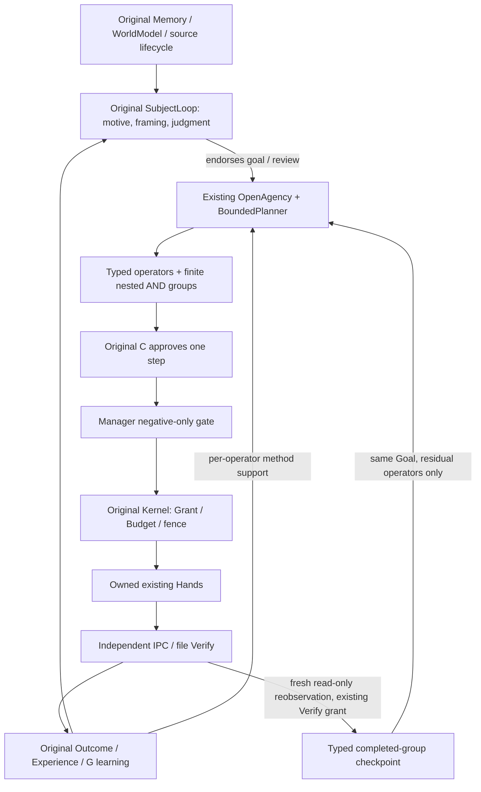

# Precision V2 — implementation and qualification

Advanced Growth S2/S4/S5/S6/S7/S8/S9 and three axes, GLOBAL_STAGE H.
Base d695ed7d47a33cb3df62a144908df30b7d7c693d on the existing development branch.
Master and the fixed63 Foundation definitions are unchanged. Historical controlled
world residency stays PARTIAL_EXTERNAL_LIMIT, never reinterpreted as completed.

## P0 — frozen representative baseline, before runtime changes

`tools/nana_precision/benchmark.py` defines independent transition replay; the
planner subprocess receives only typed public operators/goals, not evaluator
answers. Twenty-four development cases vary chain widths/depths/costs/order,
alternative paths, irrelevant work, producer-specific dataflow, destructive
branches and impossible goals. Seed24102026. Evaluator and generator are frozen
in this commit before candidate changes. Final unseen seeds will be drawn only
after candidate freeze; no tuning on final instances or answers.

Baseline: `nana_precision_v2_evidence/baseline.json`:9/20 feasible completions,
13/24 correct including impossible cases,4 invalid proposals,0 accepted false
success,0 duplicate operators. Invalid proposals are wasted planning, not
successful Actions or falsely verified world effects. This is symbolic
ARCHITECTURE_PRECISION, not semantic intelligence. MODEL_ABLATION_NOT_RUN.

## Gap map and selected change

1. Uniform-cost enumeration expands independent step orders before reaching a
   multi-branch goal; its1024-expansion bound rejects feasible tasks.
2. Planner state tracks facts only, though validator also requires exact producer
   history and forbids repeated operator IDs. Cheap unrelated producers hide
   necessary dataflow paths.
3. Flat32-operator/step/cursor bounds prevent bounded larger decompositions.
4. Existing replan deliberately discards prior outputs and fences UNKNOWN effects.
   Reusing writes from symbolic facts alone would be unsafe; retain fresh-source/C
   review and do not introduce speculative write reuse.

Chosen: evolve the existing BoundedPlanner with causal relevance, explicit
producer history and finite heuristic search; add typed bounded hierarchical
groups using the original Goal/Plan/one-step C execution. Independent validation
and Manager/Grant/Budget/Verify remain. Satisficing search, not global cost-optimality.
No alternate will/planner/store/daemon. No schema change needed for typed plan data.

Pending: implementation, targeted/development comparison, candidate freeze,
unseen heldout comparison, original-runtime integrated lifecycle, compatibility,
recovery, portable install, full regression and layer-qualified final report.

## P1 — substantive implemented change

Causal relevance and explicit producer history replace combinatorial UCS enumeration
in the existing planner; 1024 expansions,8192 frontier,128 operators/steps,32 AND
groups/depth8. Primitive OR alternatives remain ordinary competing producers.
No claim of optimality, arbitrary recursive HTN or universal planning. Legacy
objectives omit new default fields byte-for-byte. Original C approves every step.

InputStateGuard binds a declared independent observation with finite age/revision;
it inhibits a new dispatch, never prevents reconciliation of an existing UNKNOWN.
Kernel.reobserve uses an existing Verify Grant, attempt, budget hold and independent
port. It appends current evidence without rewriting historical Action outcome.
Only fully completed typed groups with current independently matching checked
write effects are reused. Dataflow/predicate facts come from these checked groups;
remaining operators replan in the same Goal and plan lineage. If current effect
is inconclusive/changed, reuse fails closed. No network or Grant is created.

Fresh source/C review remains required. A verified effect without step progress
forces reconciliation first. C-endorsed plan revision atomically defers obsolete
step intentions, retains their original judgments, and has a durable source key
for commit-before-ack recovery. Two actual SIGKILL cuts pass.

An optional per-operator domain prevents document lessons being applied to Files
or Forms; actual quality failures remain original Experiences. Optional
LearningSpec.hypothesis_policy=PRACTICE_COMPARE compares finite reviewed methods
on public practice only, after original C chose learning. Original independent
BASELINE/EVALUATE/TRANSFER/activation/monitoring remain authoritative. This exposes
practice competition beyond the old first-nominee fixture; it does not replace
original meta-learning or claim autonomous discovery of unlisted algorithms.

23 targeted PASS. Actual owned integrated9-step hierarchy had natural document
and form failures, original G learned two methods, original C revised the same
Goal; current Kernel evidence retained the completed6-step prefix and only3
steps executed. Actual file move executed once. A real local HTTP timeout remains
UNKNOWN with different-poll retry denied. Full/heldout/install still pending.

## Architecture and precision dimensions

D remains the existing opportunity scheduler. The graph has one C, one D, one
Store and one will. Planner input is data. Checkpoint facts are not adopted goals,
model authority, permanent world truth or Grants. Host policy alone cannot make a
Goal; source/current C approval and separate realization gates remain mandatory.

| Dimension | Existing mechanism and measured limitation | Choice / actual scope |
|---|---|---|
| PRECISION-00 /10 | Original tests plus1510 baseline; no representative same-definition complex search comparison | Frozen evaluator,24 dev,24 unseen parameter/order cases,18 unseen random state graphs; independent oracle and20 existing integration categories. No benchmark-only stop. |
|01 S6/F | Uniform-cost1024 enumeration; fact-only state hides required producer;32 flat operators | Causal relevance/history, heuristic finite search, typed nested AND barriers, OR via competing primitive producers,128 total steps/depth8; actual37-step C/Kernel restart. Not arbitrary recursive HTN/global optimum. |
|02 S7/A | Existing effect_slot,Grant,reservation,UNKNOWN,independent Verify already present | Add independently budgeted Kernel reobservation; reuse checked effects, never retry. Current evidence is separate from immutable historical success. No new executor/authorization scheme. |
|03 S5/E +S2 | Original sourced/temporal/conflict WorldModel; task dataflow lacked explicit freshness | Add TaskStateFact/InputStateGuard; finite age/data digest before new dispatch and current independent checkpoint effects. Source deletion still invalidates support. Not universal external CAS or comprehensive world model. |
|04 S6/C | Existing FrameAssessment/context-fit/source-premise tests,63criteria S6 qualification | Preserve; actual casual/correction/refusal/framing regression. No evidence justifying another cognition brain. Open semantic generalization NOT_RUN; this is not evidence that arbitrary problem discovery is solved. |
|05 S4/D,S6/F | Original priority/aging/dependencies/pause; heterogeneous composite tasks lost primitive domain | Keep scheduler; per-op domain + same-goal residual plan. Preserve old failures and physical effects. Reuse verified prefix instead of repeating a non-idempotent file move. |
|06 S8/G | Original nine stages,meta practice filter,independent heldouts,monitor/rollback; default nominee could be poor | Expose bounded PRACTICE_COMPARE on original G, no heldout in proposer; per-task lesson use. Old proposer-only run fails, candidate later task completes. Finite declared methods only; no new learning brain or universal meta-learning claim. |
|07 S5/S7/S9,Platform | Existing sealed registry/typed Hand target/resource/preflight/Verify; simulator gestures only | Reuse. No evidence requiring nine new device adapters. Source/model change does not mint device permission. Actual phone/desktop/game operation NOT_RUN. |
|08 S1/S3,Shared Life | Original needs/rest/context-fit/relational support/busy/refusal/shared candidate | Preserve and rerun. Human naturalness NOT_RUN. No new emotion KPI,persona rewrite,sharing quota or compulsory learning. |
|09 S1/S4/Governance | Existing Store/lease/CAS/backup/quarantine; stale pending step and replan commit→ack gaps | Atomic superseded-step DEFERRED history, idempotent revision key, reobserve both actual SIGKILL cuts. Changed checkpoint parks review rather than owner crash; no new owner or execution permission. |

## Action / evidence contract and outcomes

The existing action_id/goal_id/plan_id/identity/epoch, exact capability/resource,
args hash,effect slot,Grant,holds,attempt,receipt,verification event and source
payload are reused. New state guard and TaskCheckpoint are strict DTOs; checkpoint
format VERIFIED_TASK_PREFIX_V1 binds original operator/action/memory/check IDs,
requires MATCH/current expected digest and carries no executable rule or authority.
They are stored in existing privacy-linked records/artifacts, not untyped new
standalone persistent state or a second Store.

Observe → C approves → state dependency check → Manager → Kernel authorizes and
reserves → original Hand → receipt → independent Verify → quality Experience →
continue / original-C replan. A dispatched/unknown effect always uses original
Verify; a new stale-state check cannot erase or rerun it.

| Precision meaning | Actual authoritative representation |
|---|---|
| PRECONDITION_FAILED / RESOURCE_CHANGED | STATE_DEPENDENCY_* park, existing stale DOM/target revision preflight; no new dispatch |
| CAPABILITY_UNAVAILABLE | Existing sealed registry/port error; no substituted capability |
| AUTH_DENIED | Existing Action BLOCKED or distinct Manager veto; neither becomes Subject RESTRAINED |
| TIMEOUT_UNKNOWN | Existing action/intake UNKNOWN; no blind dispatch/fallback |
| EFFECT_MISMATCH | Existing independent EFFECT_MISMATCH / FAILED_EFFECT |
| VERIFIED_NO_EFFECT | Existing FINAL_NO_EFFECT / NOT_APPLIED |
| PARTIAL_EFFECT | Domain independent observations retain partial actual state; inconclusive is UNKNOWN, never guessed no-effect. No universal partial-fraction oracle added. |
| SUCCESS_VERIFIED | Action SUCCEEDED is mechanical Verify; expected_digest/Experience separately determines task-quality success |

Compensation remains an explicitly authorized new action, not a fabricated true
rollback. Completed world effects are not erased when their supporting memory is
withdrawn. Arbitrary irreversible/unknown effects have no automatic compensation.

## Compatibility, cost and limits

Schema13/43 tables,new tables0,new dependencies0,new runtime processes0. New
persistent content is typed plan group/checkpoint metadata and original Verify
attempts/payloads/events, subject to existing deletion/backup/replay. No migration
of production or current human Subject. Legacy default Objective/Operator/LearningSpec
serialization omits optional fields. An old executable rejecting new payloads is
fail-closed; do not hot-downgrade a live extended plan.

Heuristic search bounds remain finite, never a proof an exhausted task is impossible.
Stored reobservations add read cost proportional to completed groups. A changed,
revoked or unavailable target cannot be reused. Fresh evidence and original C are
required to reconsider. No source module can certify its own arbitrary correctness.

Historical5h run remains PARTIAL_EXTERNAL_LIMIT. New long-plan/resource qualification
is PENDING_EXTERNAL_STABLE_ENV; neither this task's short actual integration nor
virtual cases are hours of continuous life. Real model/tool ablation and semantic
comprehension are NOT_RUN. Scope is owned/dev with deterministic finite semantic
contracts and independently observed local effects, not general open-world AGI.
