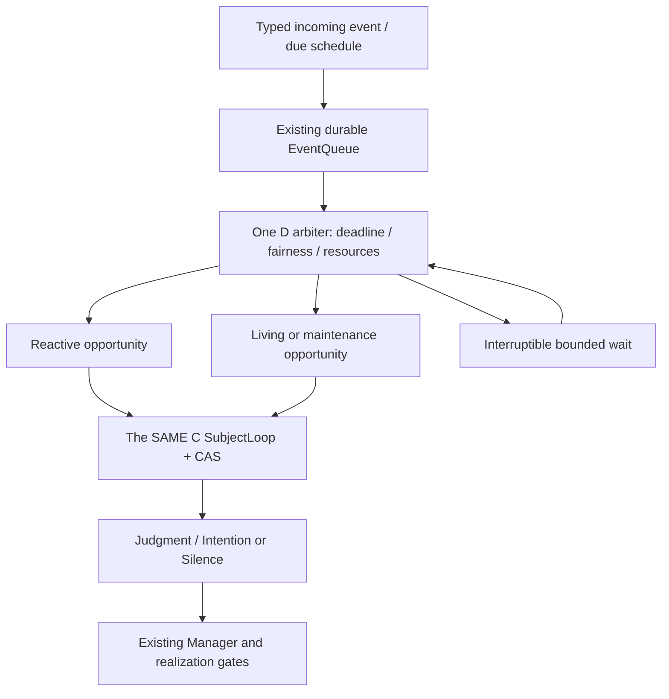

# NANA_LIVING_RUNTIME_V2_CONCEPT — DESIGN_ONLY

## 唯一推荐下一施工：D-V2 Bounded Preemptible Cadence

不扩权限，不导入外部runtime，不改C的价值/人格。D决定WHEN，C决定WHAT/WHY。唯一Store/lease/SubjectLoop保持。

现状 source：[`src/nana_core/presence/runtime.py:194`](https://github.com/xuni7-ui/nana-core/blob/67326d195edd0693d41eacc63fcc00e1c3205bd6/src/nana_core/presence/runtime.py#L194) 固定poll sleep；step在FULL cognition/subject commit期间同步；queue已有priority/stream ordering，但在飞后台工作不能由新user event完整抢占。

Reactive不是“用户意志更权威”；只是延迟敏感输入。不要像YuriOS现状保留另一个reply brain。语音渲染/transport可以异步，正式decision只有C。

## 调度合同

输入：queue ready/due/stream ordering，nearest deadline，lease heartbeat deadline，bounded backlog，maintenance safe point，cognition reservation，source revision。
输出：next check deadline、eligible queue ID、mode resource offer、pause/drop/continue hint；无motivation/value/relationship总分。
next wait=min(next due, heartbeat requirement, stop signal, maximum idle cap)；实际实现用可打断condition/event，不能长sleep错过incoming。deadline overdue合并，不逐漏tick补跑。

| 机制 | 来源 | 保留/变化 |
|---|---|---|
| reactive+living opportunities | YuriOS + Nana queue新组合 | 单C，serialized authoritative commit |
| adaptive interval | YuriOS ladder/Anima backoff | bounded/injectable/deterministic，不依随机或affection |
| cheap appraisal | Nana已有NO/LIGHT/FULL、YuriOS | 不重复做另套判断；D调用C现有pure appraisal |
| optional model | Nana已有 | reserve-before-call，late response state token验证 |
| one committed intention | Nana/YuriOS | 一个cycle≤1；zero正常，候选/目标可多 |
| user preemption | YuriOS可借 | 只在safe point暂停；已发effect不能假装取消 |
| maintenance slices | YuriOS DREAM/Letta | worker仅提出带source revision的candidate，单writer验证 |
| journal | YuriOS借UX/Nanaauthoritativehistory | read projection，不另建事实文件 |
| separate background resources | YuriOS hands budget | 子额度≤总hard额度；不同call类不互相饿死，不发Grant |
| reach-out gate | YuriOS pattern/Nana social proposal | worthwhile≠interruptible≠authorizeddelivery |
| catchup | Nana已有coalescing/YuriOSgap | 每source/revision一个opportunity，过期按语义处置 |

## NANA_ALWAYS_ON_COST_MODEL

| 类别 | 常规成本 | authority/失败行为 |
|---|---|---|
| no-model wake | queue/time/lease轻IO | 不制造Experience或社交；无重要输入保持quiet |
| cheap derived appraisal | bounded source/header/projector CPU | privacy先过滤；no LLM；无新的事实authority |
| optional cognition | frozenContext/LLM候选 | 总额内预留input/output最大值；timeout/UNKNOWN不盲重试 |
| expensive research | 多model/tool/资料预算 | E/G阶段，当前不实现；独立子额度，仍Grant/Manager/Verify |
| background consolidation | boundedbatch+可选utility/embed | same-source/version去重；结果proposal，stale/deleted拒绝 |
| real action | capability运行+核验cost | 另需scope/Grant/Budget/lease fence；costmodel不创造权限 |

当前D是max_calls/day+bytes/可空actual_tokens；不能宣称已经是准确token账单。未来`reserve>=max_input+max_output+boundedtoolcontext`，provider真实usage仅settlement，不靠chars/4当安全上限。foreground也受总硬预算；“聊天永不被cap挡”不可照搬，保留低成本解释/无模型降级。

## Preemption / commit / crash

- background compute在no-effect safe point可cancel/pause，保存progress refs，不保存可重用执行许可。
- LLM返回前后验证epoch/source/context freshness；过期候选丢弃，不重写旧Judgment。新user事件不能偷偷合并改变旧source。
- C commit中不interrupt半事务；完成/rollback后调度reactive。action已dispatch则UNKNOWN+Verify，不把取消当NONE。
- incoming wake不可清空后漏通知；condition检查与sleep必须同一protocol，lost wake回归必要。
- storm control：boundedqueue、per-source dedupe、fairness/agedlowpriority、maxbatch；不是每次backlog都固定5秒烧模型。
- 恢复只重排机会；已commit C cycle ack，reserved provider UNKNOWN，timer stable occurrence，不重复promise/disclosure。

## Background Maintenance Window（后续独立施工，不混入首milestone）

eligibility：no urgent eligible queue、资源余量、有合法finished source backlog；window不是心情/新SubjectLoop。
workunit：(job_kind, source_ids+revisions, privacy, boundedcursor, deadline, maxcost)。首项太大也必须split或BLOCK，不突破hardcap。jobs可以proposal consolidation、indexrebuild、conflict review、archive checks；不自动selfedit或selfresearch外网。
输出candidate+coverage+explanatoryrefs；原始Evidence仍在；删除/纠错打断并使proposal失效。模型输出不得产生Identity/Manager/Grant/unsupported Memory。

## 最小接口/验收/边界

建议扩展现有Runtime内部wait/admission，不提前锁最终类名。接口语义：`next_opportunity(now, queue_head, due, lease)`、`pause_at_safe_point(work_id, revision)`；不暴露通用RPC执行。
验收：相同event顺序→同decision；incoming latency不再受idle poll上限拖累；背景slice中incoming可抢占；deadlines/heartbeat不饿死；90virtualdays no-modelquiet多数；SIGKILL/replay/epoch/UNKNOWN沿用现有证明；action/model真实调用仍0。
成本SMALL–MEDIUM（调度与safe-point边界），若改成异步C writer则LARGE并需新裁决。没有设未经测量的p95或token节省数。
多goal planning/真实body/模型E12不包含。停在单一Subject完整性，不为“living”保证activity/message数量。
